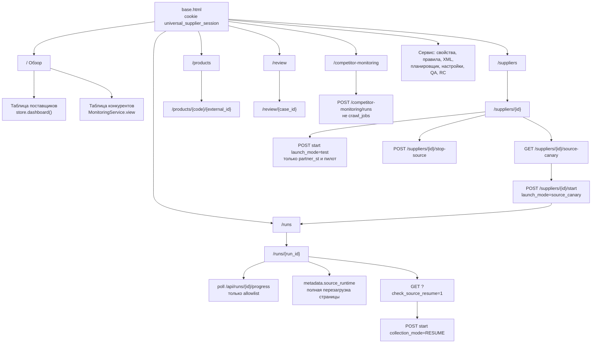

# Кабинет оператора STERBRUST

| Поле | Значение |
|---|---|
| Статус | Draft |
| Автор | _placeholder_ |
| Дата | 2026-10-22 |
| Аудитория | Codex, встраивание в существующую панель FastAPI/Jinja |
| Репозиторий | `D:\documents\personal\ChatGPT\Стербруст\work\sku-service-unified-rc-20261019` |
| Ветка | `feature/sterbrust-unified-rc-20261019` |
| HEAD | `34739cbff85c758dfaafdd27b923c9aa1e3361a9` |
| Subject HEAD | Fix scoped linked source refresh without changing catalog identity |
| `git status --short` | см. блок ниже; снято `git status --short` при правке, HEAD тот же |
| База спецификации | Чистый `34739cb`. Поведение RESUME, STOP и `claim_next` берётся из этого commit, не из рабочего дерева. |
| Тип документа | Спецификация UX/UI. Код репозитория этим документом не меняется. |

`git status --short` на момент правки (не чистить):

```
 M scripts/qa_source_runtime_offline.py
 M universal_supplier/control_plane/queue.py
 M universal_supplier/control_plane/source_backend.py
 M universal_supplier/control_plane/source_runtime.py
?? config/live11_approval_matrix.csv
?? docs/LIVE11_BATCH_WORKFLOW.md
?? scripts/source_batch.py
?? tests/test_source_batch.py
?? universal_supplier/control_plane/source_batch.py
```

`git grep source_batch HEAD` по `queue.py`, `source_backend.py` и `source_runtime.py` пуст. Незакоммиченный `universal_supplier/control_plane/source_batch.py` — это реальный enqueue пакета, не заглушка. Его нет на HEAD `34739cb`. Грязный `queue.py` добавляет `preview_source_batch`, `enqueue_source_batch`, `source_batch_status`, `stop_source_batch` и меняет не только пакет: `claim_next` берёт `pg_advisory_xact_lock(8611011)`, отменяет просроченные строки `source_batch`, ограничивает claim, а `complete` вызывает `advance`. Грязный `stop_source` делает `mkdir` каталога checkpoint. На HEAD `stop_source` каталог не создаёт: если `job_dir(...)` не каталог, метод поднимает `ValueError('SOURCE_CHECKPOINT_NOT_STARTED')`. На HEAD `claim_next` выбирает одну строку `status='queued'` через `FOR UPDATE OF j SKIP LOCKED LIMIT 1`, при включённом partner pilot проверяет снимок `partner_st` и затем ставит `running`. Лока `8611011`, потолка из двух `running`, отмены строк `source_batch` и вызова `advance` из `complete` на этом commit нет. Кабинет `claim_next` не меняет и из грязного diff не берёт.

PR кабинета diff'ятся против `34739cb` и не стейджат, не импортируют и не вызывают: `universal_supplier/control_plane/source_batch.py`, `scripts/source_batch.py`, `tests/test_source_batch.py`, `docs/LIVE11_BATCH_WORKFLOW.md`, `config/live11_approval_matrix.csv`, а также незакоммиченные hunks в `queue.py`, `source_backend.py`, `source_runtime.py`, `scripts/qa_source_runtime_offline.py`. Не вызывать `preview_source_batch` / `enqueue_source_batch`. Второй batch-маршрут не добавлять.

Документ описывает только перекомпоновку существующей серверной панели. Новых таблиц, миграций, эндпоинтов записи, второго фронтенда и второго приложения нет.

## Overview

Оператору нужна одна уже существующая админка, в которой видны все строки `suppliers`, которые вернул store, и отдельно все строки `competitor_sources`, которые вернул мониторинг. Из этой панели он готовит одно ручное задание поставщика через уже существующие GET `/suppliers/{id}/source-canary` и POST `/suppliers/{id}/start`, смотрит HTTP-ход и SQL-ход как разные факты, открывает товар с текущей проекцией цены и историей, разбирает REVIEW и CONFLICT существующими формами и сравнивает цены конкурентов, не записывая их в `offers`.

Сейчас `/` рисует сетку карточек из `templates/dashboard.html`, а конкуренты живут на `/competitor-monitoring`. Плотность карточек прячет очередь, режим, политику host и причину, почему кнопка недоступна. Кабинет оставляет те же URL и те же POST, заменяет карточную мозаику таблицами и правой рейкой и явно делит экран на контуры «Поставщики» и «Конкуренты».

Число строк на экране равно числу строк запроса. Имена 11 кодов collectors в `docs/source-runtime.md` и 12 кодов в `competitor_intel/execution.py` — конфигурация, не живой `COUNT(*)`. Live SELECT для этой спецификации не выполнялся.

## Background & Motivation

Панель — `create_app` в `universal_supplier/control_plane/web.py`. Шаблоны Jinja лежат в `universal_supplier/control_plane/templates/`. Стили: `static/app.css` (каркас, `main { max-width: 1360px }`, карточки `.cards`), `static/stage6e.css`, `static/rc_ui.css` (уже умеет `.tablewrap` и статусные бейджи). Скрипт `static/app.js` маленький, диалоги уже есть. Язык интерфейса русский. React нет.

Навигация в `templates/base.html` сегодня плоская: Главная `/`, Товары `/products`, Требует проверки `/review`, Автосопоставление `/automatic-matching`, Поставщики `/suppliers`, Запуски `/runs`, Качество данных `/data-quality`, XML-выгрузка `/exports/xml`, Свойства `/properties`, Правила и исключения `/rules`, Планировщик `/scheduler`, Настройки `/settings`. Условно добавляются «Ручной сбор» и «Сопоставление и файлы» при `commercial_qa_available`, «Мониторинг конкурентов» при `monitoring_available`, ссылки на `/release-jobs` и `/rc-final` при флагах. Роли `ADMIN` / `OPERATOR` / `VIEWER`. Мутации поставщика и проверки: `MUTATING_ROLES = {ADMIN, OPERATOR}`. Cookie сессии: `universal_supplier_session` (`security.py`). CSRF проверяет `check_csrf`. Футер уже говорит: «Запись и импорт в Sterbrust отключены». Баннер: «ИМПОРТ В STERBRUST ОТКЛЮЧЁН — КОНТРАКТ ИМПОРТА НЕ ПОДТВЕРЖДЁН».

Боли, которые кабинет снимает без новой очереди:

- Карточка поставщика на `/` не отличает HTTP от SQL и не показывает, почему сбор нельзя начать (runtime выключен, поставщик `enabled=false`, нет host policy, control plane read-only, включён пилот Partner-ST).
- Инлайн-скрипт `run_detail.html` подставляет `` `${p.processed||0}` `` и ставит `bar.value=p.percent`, если `percent` не `null`, в том числе в фазе DISCOVERY. Поле `succeeded` в allowlist есть, но этот скрипт его не читает и не пишет `errors||0`. При `!r.ok` функция делает `return` и больше не опрашивает. Это нельзя переносить как есть.
- `succeeded` в JSON прогресса имеет разный смысл у двух writer'ов. Колонка SQL из этого поля запрещена.
- Конкурентный сбор — другой процесс: `POST /competitor-monitoring/runs`, не `crawl_jobs`.
- Commercial QA (`/commercial-qa`) — диагностический контур исторических источников, не сбор collectors и не LIVE.
- Generic `full` без cap и preview для всех 11 уже запрещён (`EXPLICIT_COLLECTION_SCOPE_PREVIEW_REQUIRED` в `queue.enqueue`, кнопка «Запустить сейчас» в `supplier_detail.html` только если `item.code not in manifest_sources`). Возвращать её нельзя.

## Goals & Non-Goals

### Goals

- Одна оболочка, два контура, которые не смешиваются в таблицах, очередях и отчётах.
- Все существующие URL продолжают открываться.
- Оператор видит каждую строку `store.suppliers()` / `store.dashboard()` и, отдельно, каждую строку, которую вернул `MonitoringService` из `competitor_sources`.
- Запуск поставщика только тем POST, который очередь уже принимает: один источник, явный cap, preview SHA-256.
- HTTP и SQL на экране задания — разные колонки с разными источниками данных.
- REVIEW и CONFLICT объясняются текущими статусами и формами. Ложное подтверждение не предлагается кнопкой.
- Сравнение цен конкурентов остаётся в мониторинге.
- Отчёт после сбора читает уже записанные `crawl_runs` и `entity_change_history`.
- VIEWER не видит форм старта, остановки и решения.
- Если runtime выключен, причина видна текстом, а не пустым местом.

### Non-Goals

- Миграции, новые таблицы, изменение matcher, `security.py`, второй app, запись строк конкурентов в `offers`.
- `POST /batch` и любой пакетный enqueue. Не вызывать методы грязного дерева `preview_source_batch` и `enqueue_source_batch`. Не переносить hunks `source_batch` из рабочей копии `queue.py`.
- Включение `supplier_schedules` и планировщика конкурентов (`competitor_intel/schedule.json` имеет `"enabled": false`).
- Деактивация отсутствующих товаров из UI. Импорт в sterbrust.com. Запись ESOL/Sterbrust.
- Слайдер скорости, который пишет новую host policy.
- Возврат кнопки generic `full` для кодов `RUNTIME_SOURCES`.
- Слияние пилота Partner-ST (`launch_mode=test`, `POST /suppliers/{id}/stop-pilot`) с REFRESH / DISCOVERY / RESUME.
- Автоматическая кнопка сбора для `youmet`.
- Новая библиотека графиков цен.
- Приёмка живым обходом сайтов или живой БД.

## Proposed Design

### Information architecture

Оболочка одна: `base.html`, cookie и CSRF те же. Контуры не имеют общего ключа строки. Поставщик идентифицируется `suppliers.id` / `suppliers.code`. Конкурент идентифицируется `competitor_sources.code`, который мониторинг уже кладёт в `monitoring.sources`. Связывать их join'ом нельзя.

Первичная работа оператора, слева направо:

| Подпись | URL | Контур | `active` |
|---|---|---|---|
| Обзор | `/` | оба, двумя таблицами | `dashboard` |
| Поставщики | `/suppliers` | Поставщики | `suppliers` |
| Запуски | `/runs` | Поставщики (`crawl_jobs` / `crawl_runs`) | `runs` |
| Товары | `/products` | Поставщики | `products` |
| Проверка | `/review` | Поставщики, сопоставление | `review` |
| Конкуренты | `/competitor-monitoring` | Конкуренты | `competitor_monitoring` |

Вторичные инструменты остаются ссылками в блоке «Сервис», не в основном ряду: `/automatic-matching`, `/data-quality`, `/exports/xml`, `/properties`, `/rules`, `/scheduler`, `/settings`, при флагах `/commercial-qa`, `/commercial-qa/proposals`, `/release-jobs`, `/rc-final`. Планировщик открывается, но кабинет не добавляет туда включение расписания и не меняет `POST /scheduler/{supplier_id}`.

Запуск сбора — не новый маршрут. Это секция `supplier_detail.html` плюс `source_canary.html`. Задание — существующие `/runs` и `/runs/{run_id}`. Итоговый отчёт — перекомпоновка `/runs/{run_id}`, не новый GET. Товар — `GET /products/{supplier_code}/{external_id}`. Сопоставление — `/review` и `/review/{case_id}`.



На `/` две таблицы стоят друг под другом или, на широком экране, в двух колонках оболочки. У них разные заголовки контура, разные колонки и нет общей строки «источник». Пустой результат конкурентов — пустая таблица с текстом, не подстановка 12 кодов из `execution.SOURCES`.

Различие справочников конкурентов, которое экран обязан произнести:

- `competitor_intel/execution.py` `SOURCES` — допустимые коды процесса сбора: `kuvalda_nnov`, `metalmaster`, `jet_online`, `stanki_ru`, `titaniumgroup`, `youmet`, `jettools_ru`, `rustan`, `belmash`, `harvey_rus`, `amur_stan`, `lasercut_ru`.
- `competitor_intel/model.py` `SOURCES` сейчас задаёт только `kuvalda_nnov`, `metalmaster`, `lasercut_ru`. Это не список экрана.
- Экран читает таблицу `competitor_sources` через `MonitoringRepository.load` в `competitor_intel/monitoring.py` (`SELECT id,code,name,base_url,region,enabled ... ORDER BY id`) и дальше `MonitoringService.view`. Имя — `name` из этой выборки. Число строк — `monitoring.sources|length` после загрузки, не константа.

Коды collectors, для которых действует пакет source-runtime (`source_jobs.RUNTIME_SOURCES`): `beka_mak`, `beka_mak_tr`, `intervesp`, `vekprom`, `kami`, `ltt_msk`, `ltt_sib`, `ltt_yug`, `uss_stanko`, `partner_st`, `optimum`. Подпись строки — `suppliers.name`. Код показывается второй строкой как `suppliers.code`. Если запрос вернул другой набор, рисуются все возвращённые строки. Действие «пакет» есть только у кода из `manifest_sources` (это тот же `RUNTIME_SOURCES`, уже передан в контекст).

### Общие компоненты

Новые классы только в `static/rc_ui.css`, под селектором `body.cabinet`, чтобы страницы без этого класса сохранили вёрстку `app.css`. Макросы — один include `templates/cabinet_macros.html`. Второй JS-бандл не создавать. Опрос задания остаётся инлайн-скриптом `run_detail.html` с nonce CSP, как сейчас.

| Компонент | Поведение |
|---|---|
| Shell | `body` получает класс `cabinet`, если `active` один из `dashboard`, `suppliers`, `runs`, `products`, `review`, `competitor_monitoring`. Шапка, баннер импорта и футер не переписываются. |
| Contour badge | `.contour-supplier` текст «Поставщики». `.contour-competitor` текст «Конкуренты». Цвет — тонкая рамка, не градиент. |
| Status chip | `.status-ok`, `.status-warn`, `.status-stop`, `.status-unknown`, `.status-manual`. Текст чипа — глагол состояния, не число. |
| HTTP column | Только поля allowlist `run_progress`, кроме `succeeded`. Подпись колонки: «HTTP poll». |
| SQL column | Только `metadata.source_runtime` после рендера страницы, либо `phase_summary` для старого run без `source_runtime`. Подпись: «SQL снимок страницы». |
| Freshness | Для товара: `commercial_observed_at`, `changed_at`, `observed_at`, `field_observations.observed_at`. Для конкурента: `latest_observed_at` и `monitor_time`. Пустое время — «нет данных», не «только что» и не 0. |
| Confirm dialog | Существующий `<dialog>` из `app.js` (класс `open-dialog` / `close-dialog`). Диалог повторяет уже введённые поля и не подставляет новый cap. |
| Preview digest | `preview.confirmation_sha256`. На экране первые 16 символов и полный digest в `<code class="wrap-anywhere">`. Скрытое поле формы не пересчитывается в браузере. |
| Stop reason | Сырой `termination_reason` или `metadata.failure`, плюс короткая русская глосса только для известных литералов ниже. Неизвестный литерал: сам код и «не классифицировано». |
| Unknown-count cell | Класс `.count-unknown`. Текст «нет данных», только если ключа нет или значение `none`. Присутствующий целый `0` у `sql_committed` и `sql_committed_this_job` печатается как `0`. Это не «нет данных». `price_on_request`, пустая цена и пустой Sterbrust ID по-прежнему не `0`. |

Глоссы остановки, только если строка равна коду или начинается с префикса. Иначе не угадывать.

| Как записано | Что сказать оператору |
|---|---|
| `OPERATOR_STOP` | Локальная остановка source-runtime. На HEAD `queue.stop_source` пишет `OPERATOR_STOP` в `STOP_REQUESTED`, только если каталог checkpoint уже есть. Это не пилот. |
| `STOP_REQUESTED` | Остановка пилота Partner-ST или native crawl. Не называть её остановкой source-runtime. |
| `SOURCE_BLOCKED_HTTP_403` | Хост остановлен: 403. |
| `SOURCE_BLOCKED_HTTP_429` | Хост остановлен: 429. |
| `SOURCE_RETRY_AFTER_HTTP_503` | 503 с Retry-After. Хост остановлен. |
| `SOURCE_BLOCKED_INTERSTITIAL` | Антибот / interstitial. Хост остановлен. |
| `ROBOTS_DISALLOW`, `ROBOTS_NOT_PROVEN`, `ROBOTS_REQUIRES_SLOWER_PROFILE` | Robots. Не предлагать другой интервал формой. |
| `HOST_LEASE_LOST`, `CURRENT_HOST_LEASE_REQUIRED`, `HOST_LEASE_REQUIRED` | Потеря или отсутствие lease. Новые запросы и SQL ingest этому заданию запрещены кодом. |
| `MAX_RUN_DURATION_EXCEEDED` | Дедлайн задания. Не 403 и не SQL. |
| `SAFETY_GATE_SQL_NOT_PROVEN`, `SQL_COMMIT_NOT_PROVEN` | Остановка из-за SQL. HTTP-процент это не лечит. |
| `SOURCE_CARD_HTTP_FAILED`, `SOURCE_CARD_PARSE_FAILED` | Карточка. Смотреть `error_details`, не подменять причину словом «ошибка сети». |
| `SOURCE_REQUEST_NOT_DISPATCHED` | До входа в transport, `transport_started=false`. Это не UNCERTAIN. |
| состояние `UNCERTAIN` в receipt | Потерянный ответ после старта transport. Даже при `attempts=0`. Автопродолжения нет. |

`host_fetch.stop` сохраняет первую причину (`FIRST_STOP`: `if first: self.stop_reason=reason`). Экран показывает одну строку `termination_reason`, не список догадок.

Флаги в шапке кабинета, читаемые, не как права оператора:

- `source_runtime_enabled` уже в `context()` (`STERBRUST_SOURCE_RUNTIME_ENABLED=='YES'`). Если ложь: чип «кнопка недоступна, сбор не LIVE» и текст «Режим collectors не включён». Кнопки preview/start не рисовать активными. Ссылку на поставщика оставить.
- `STERBRUST_ALLOW_SUPPLIER_HTTP` и `STERBRUST_ALLOW_SOURCE_WRITES` проверяет worker в `source_runtime.py` (`LIVE_SUPPLIER_HTTP_NOT_AUTHORIZED`, `SOURCE_WRITES_NOT_AUTHORIZED`), не `start_now`. В контексте шаблона их сейчас нет. PR1 добавляет в `context()` два булева чтения `os.environ`, без изменения enqueue. Подписи: «HTTP поставщика воркером не разрешён» и «SQL-запись source-runtime воркером не разрешена». Пока флаг ложен, кнопка preview остаётся доступной только если runtime включён: оператор может открыть снимок, но шапка говорит, что worker запись/HTTP не выполнит. На `supplier_detail.html` и `source_canary.html` подстрока `LIVE` допустима только внутри фразы «не LIVE». Голое «LIVE разрешён» не писать даже при трёх флагах `YES`. Коды ошибок worker в шаблон не копировать.
- `control_plane_read_only` уже есть. Текст существующий: обычные изменения заблокированы. Не называть этот режим LIVE.
- `partner_pilot_enabled` уже есть. Если истина, source-runtime формы на карточке поставщика уже скрыты условием `not partner_pilot_enabled`. Кабинет это сохраняет и подписывает соседний блок: «Пилот Partner-ST. Не REFRESH, не DISCOVERY, не RESUME».

Счётчики. Разрешены только те, что store уже вернул, с подписью смысла:

| Число | Откуда | Подпись на экране |
|---|---|---|
| `review_counts.open` | `review_cases` где `lifecycle_status<>'RESOLVED'` | «кейсы не в RESOLVED» |
| `review_counts.conflicts` | не RESOLVED и `automatic_decision='CONFLICT'` | «CONFLICT в открытых кейсах» |
| `review_counts.new_candidates` | не RESOLVED и `SAFE_NEW_PRODUCT_CANDIDATE` | «SAFE_NEW_PRODUCT_CANDIDATE в открытых кейсах» |
| `review_counts.errors` на `/` | сумма `errors_30d` по строкам dashboard | «строки crawl_errors за 30 дней, сумма по поставщикам» |
| `review_counts.queued` | сумма `has_queued_job` | «поставщики, у которых есть crawl_job queued» |
| `review_counts.running` | сумма `has_running_job` | «поставщики, у которых есть crawl_job running» |

Это не число заданий в `/runs`: `/runs?job_status=queued` режет `LIMIT` (в `store.runs` по умолчанию 100) и считает строки `crawl_jobs`. Подпись обязана говорить «поставщики», не «задания». Большие цифры `.attention strong` убрать. Одна строка таблицы или компактная полоса `.cabinet-counts` с теми же ссылками: `/review`, `/review?decision=CONFLICT`, `/review?decision=SAFE_NEW_PRODUCT_CANDIDATE`, `/runs?job_status=queued`, `/runs?job_status=running`. Ссылка на ошибки не обещает фильтр, которого нет: это текст, не ссылка «на 30 дней», если отдельного URL нет.

`s.products` в таблице — колонка «активные source_products», значение `count(DISTINCT sp.id)` при `sp.active` из `store.dashboard`. Если `none`: «источник не подключён», как сейчас в `dashboard.html`. Не «0».

### Прогресс: что какому столбцу можно верить

Allowlist `run_progress` в `web.py` ровно такой: `run_id`, `supplier_name`, `run_status`, `phase`, `phase_label_ru`, `status`, `total`, `processed`, `succeeded`, `errors`, `percent`, `rate_per_second`, `eta_seconds`, `eta_human_ru`, `elapsed_seconds`, `fetch_elapsed_seconds`, `updated_at`. SQL-полей там нет.

Два writer'а кладут разные смыслы в одно и то же `metadata.progress`:

1. `CrawlProgressTracker` (`progress.py`, создаётся в `adapter_registry._tracker`). `succeeded` растёт в `complete()` на каждый `PRODUCT_COMPLETED` с `success=true`. Это не commit PostgreSQL. Фазы: `QUEUED`, `DISCOVERY`, `FETCHING_PRODUCTS`, `INGESTING`, `MATCHING`, `REVIEW_SYNC`, `FINISHED`. Подписи `PHASE_LABELS_RU`.
2. `SourceBackend.progress` (`source_backend.py`) для source-runtime. Перед записью фаза `PRODUCTS` переименовывается в `FETCHING_PRODUCTS`. В `source_runtime` внутри `metadata.source_runtime` фаза остаётся `PRODUCTS`. Поле `progress.succeeded` здесь копируется так: `summary.get('sql_committed', 0)`. Это число terminal-состояний `COMMITTED` в checkpoint, и при отсутствии ключа writer подставляет 0. Это не `sql_committed_this_job`. Это не разрешение рисовать SQL-колонку из poll. Колонка, если бы кто-то всё же показал это поле, обязана называться «progress.succeeded у SourceBackend = sql_committed или 0 по умолчанию writer'а», и кабинет её не показывает.

Вызов discovery пишет `processed: 0` явно (`source_runtime.py`, progress dict фазы `DISCOVERY`). Процент из `processed/total` в этой фазе не является поиском страниц. `discovery_visited` и `discovery_remaining` в allowlist не входят. Они видны только в `source_runtime` после рендера `/runs/{id}`.

Правило бара:

- Фазы `DISCOVERY` и сырой `PRODUCTS` не схлопывать в один бар с `FETCHING_PRODUCTS`, `INGESTING`, `MATCHING`, `REVIEW_SYNC`, `FINISHED`.
- Бар получает `value` только если в теле poll одновременно есть числовые `processed` и `total`, `total > 0`, и фаза не `DISCOVERY`. Иначе атрибут `value` снять, текст «нет данных».
- Не копировать `` `${p.processed||0}` ``. Текущий скрипт делает именно эту подстановку и двигает бар от `p.percent`, даже когда фаза `DISCOVERY`. Поле `succeeded` скрипт не читает; PR4 всё равно не начинает его читать. `errors||0` в скрипте нет и не добавлять.
- `percent` без пары `processed` и `total` бар не двигает. Если poll вернул `percent` при фазе `DISCOVERY`, атрибут `value` всё равно снять.
- Подпись бара: «доля processed/total в poll. Не полнота каталога и не SQL». Рядом, если в снимке страницы есть `external_catalog_completeness`: показать значение (`NOT_PROVEN`). Не переводить его в 100%.

SQL-колонка обновляется только полной перезагрузкой `GET /runs/{run_id}` (или кнопкой-ссылкой «Обновить снимок SQL» на тот же URL). Poll её не трогает. Автоперезагрузка допустима не чаще чем раз в 15 с и только если фокус не в `input`, `textarea`, `select` и нет открытого `dialog`. Иначе оператор сам жмёт ссылку. Новый JSON не добавлять.

Колонка SQL кабинета не печатает `phase_summary.sql_state`, если у run есть `metadata.source_runtime`. В этой ветке `presentation.phase_summary` делает `'Сверено с SQL' if runtime.get('sql_committed_this_job') else 'Новых commits не подтверждено'`. Ноль ложен в Python, поэтому присутствующий `0` и отсутствующий ключ дают одну и ту же фразу. Jinja `sql_count or 'нет данных'` прячет тот же ноль. Обе формулировки для source-runtime запрещены. Python `phase_summary` в этих PR не менять: его контракт проверяют существующие тесты. Меняется только то, что шаблон кабинета из него берёт.

Для source-runtime ячейка такая:

- ключ `sql_committed_this_job` есть и значение не `none`, включая `0`: текст «COMMITTED в этом задании: 0» (или иное записанное число);
- ключа нет или значение `none`: «нет данных», и в этой ячейке нет цифры `0`;
- то же правило для `sql_committed`: присутствующий `0` виден, отсутствие ключа — «нет данных»;
- не подставлять `progress.succeeded`, даже если writer положил туда `sql_committed` или `0`.

`SourceBackend.finish` пишет `sql_committed_this_job` в `crawl_runs.fetched_count`. Рядом, только если ключ в `source_runtime` есть: «crawl_runs.fetched_count записан finish() из sql_committed_this_job». Не подписывать её «загружено HTTP». Если ключа нет, `fetched_count` сам по себе эту подпись не получает.

Для run без `source_runtime` оставить правило `default_offer_counts` из `phase_summary`: `sql_count` равен `fetched_count`, только когда ключ `default_offer_counts` есть в metadata. Тогда печатать число, включая `0`. Если ключа `default_offer_counts` нет, ячейка «нет данных», даже если колонка `fetched_count` равна `0`. Строки `sql_state` этой ветки («Сохранено», «Ошибка SQL», «Не подтверждено») можно оставить: они завязаны на наличие `default_offer_counts` и на `failed_stage`, а не на истинность нуля. Строки source-runtime «Сверено с SQL» и «Новых commits не подтверждено» в кабинете не показывать. Текущий `runs.html` печатает `PostgreSQL: {{f.sql_state}}; сохранено {{f.sql_count ...}}` для всех run. PR4 это ветвление заменяет, а не копирует.

`new_count` / `changed_count`: если `source_runtime.sql_counts is none`, шаблон уже обязан писать «нет данных» (это есть в `run_detail.html`). Убрать соседнее `item.fetched_count or 0` и `item.error_count or (1 if failed else 0)`. Ошибки: `error_count`, если ключ есть; иначе список `item.errors` и `metadata.failure`; если списка нет и статус не failed — «нет данных», не выдуманная 1 и не выдуманный 0.

### Режимы поставщика

Тексты режимов уже в `docs/source-runtime.md` и `supplier_detail.html`. Кабинет их не меняет.

- REFRESH замораживает известные активные SQL URL и исходные `external_id`. Preview для REFRESH показывает таблицу `entries`: порядок, `source_product_id`, `source_external_id`, `url`. `total_known` — все уникальные известные URL до LIMIT. `selected` — сколько вошло в снимок.
- DISCOVERY фиксирует seeds (`source_discovery.root_urls`) и cap / pages / time. Manifest найденных кандидатов ограничен cap. Для `kami` на экране пакета одна фраза: «KAMI идёт listing/category/pagination, не filter API». Cap достигнут не значит, что внешний каталог полный. Provenance сверх cap остаётся в discovery receipts; detail HTTP и SQL сверх cap не идут. `external_catalog_completeness` показывать как есть.
- RESUME читает исходный immutable input, пропускает `COMMITTED`, дожимает сохранённые, но не committed captures офлайн, scope не расширяет. Форма не содержит `max_products`.

Safety gate оператор в форме не задаёт. `build_preview` берёт `crawl_settings.safety_gate_size` или 5, диапазон 1..20 уже проверяется. Экран показывает `c.safety_gate_size`. Слайдер не добавлять.

Cap: поле `max_products`, `min=1`, `max=100000`, `required`, без атрибута `value`. Нет default 100 и нет default 1. Пустая отправка не должна уходить: браузерная проверка `required` плюс серверный `limit_value`.

Девять wrappers (`source_jobs.SOURCES`, без `partner_st` и `optimum`) не имеют скорости по умолчанию. Показать сохранённые `item.rate_settings`: `min_request_interval_seconds`, `max_concurrency`, `jitter_min_seconds`, `jitter_max_seconds`, `request_timeout_seconds`, `max_attempts`, `max_run_duration_seconds`. Если ключа нет — «—» в этой ячейке профиля и чип «в сохранённых rate_settings поля нет». Наличие `crawl_settings.host_policy_approval` — необходимое сохранённое поле, не доказательство, что env `STERBRUST_APPROVED_HOST_POLICIES` совпал. Доказательство на этом запросе — успешный GET preview: `compile_policy` внутри `build_preview` либо пускает страницу, либо даёт 400. Не рисовать зелёный чип «политика утверждена» на карточке поставщика до этого GET. Не писать новую политику из UI.

Пилот Partner-ST остаётся отдельной формой на `supplier_detail.html`: `launch_mode=test`, `max_products` 1..50, `pilot_profile` (`conservative`, `compare_2`, `compare_4`, `compare_4_fast`), POST `/suppliers/{id}/start`, остановка POST `/suppliers/{id}/stop-pilot`. Существующий `value="50"` у пилота не переносить на source-runtime и не называть default cap collectors. PR3 удаляет из блока пилота фразу «LIVE — только по разрешённому плану» и ставит вместо неё «тест, не LIVE collectors». `build_preview` пишет `execution_mode='LIVE'` внутрь `crawl_settings` снимка. Страница canary это поле не печатает и не выводит сырой `crawl_settings`. На детали поставщика технический `<pre>{{item.crawl_settings}}</pre>` не остаётся, если из него на страницу попадает `execution_mode`: PR3 показывает только уже перечисленные поля `rate_settings` и не рендерит ключ `execution_mode`.

### UX-сценарии

Каждый сценарий кончается тем, что оператору можно считать истиной.

**1. Утро.** Открыть `/`. Прочитать полосу реальных счётчиков. В таблице «Поставщики» найти имя, код, `enabled`, последний job (`job_id`, `job_status`, ссылка на `job_run_id` или `/runs#job-{id}`), последний `last_status`. В таблице «Конкуренты» увидеть строки мониторинга или текст ошибки `MonitoringUnavailable` («База мониторинга сейчас недоступна...»). Можно верить: число строк равно ответу store/сервиса на этот запрос; счётчики означают ровно то, что в подписи; контуры не сложены. Нельзя верить: что поставщиков одиннадцать, что конкурентов двенадцать, что `products` — это очередь, что commercial-qa на соседней ссылке — LIVE.

**2. Подготовить пакет REFRESH или DISCOVERY.** Открыть `/suppliers/{id}` у строки с `code in manifest_sources`. Убедиться, что runtime включён, поставщик включён, control plane не read-only, пилот Partner-ST не перехватил экран. Ввести cap. Выбрать `collection_mode` `REFRESH` или `DISCOVERY`. Отправить GET `/suppliers/{id}/source-canary?collection_mode=...&max_products=...`. Можно верить полям снимка, которые шаблон уже печатает: `data.mode`, `c.total_known`, `c.selected`, `c.safety_gate_size`, `c.max_discovery_pages`, `c.max_run_duration_seconds`, `c.max_products`, `snap.domain`, поля `rate_settings`, `c.database.host/port/dbname`, `preview.confirmation_sha256`, для DISCOVERY список `data.seeds`, для REFRESH строки `data.entries`. Нельзя верить: что каталог сайта исчерпан, что host policy утверждена навсегда после этого экрана, что пустой cap «сам станет 100».

**3. Подтвердить preview.** На `source_canary.html` сверить SHA-256, cap, режим и target БД. Диалог повторяет их. POST `/suppliers/{id}/start` с полями `csrf_token`, `launch_mode=source_canary`, `collection_mode`, `max_products`, `source_preview_sha256`. Успех — редирект `/runs?enqueue_status=...&job_id=...`. Если digest не совпал, очередь поднимает `ValueError` с текстом «Партия, количество, политика или target изменились; заново откройте preview canary» (`queue.py`). Это 400 через `page_error`. Повторной скрытой отправки с новым SHA нет. Можно верить: в очередь встал тот snapshot, чей digest совпал в момент enqueue, либо не встал ничего. Нельзя верить: что страница 400 сама открыла новый снимок.

**4. Смотреть выполняемое задание.** Открыть `/runs/{run_id}`, когда у job есть `crawl_run_id`. Poll `GET /api/runs/{run_id}/progress` раз в 2 секунды, как сейчас, только в блок `[data-http]`. Фаза — `phase_label_ru`. Счётчик HTTP — `processed` и `total`, если оба не `null`. Скорость — `rate_per_second` с подписью «ход загрузки HTTP, URL/с», если не `null`. ETA — `eta_human_ru`. SQL-блок не меняется до перезагрузки и показывает `source_runtime.found`, `processed`, `remaining`, `sql_committed`, `sql_committed_this_job`, `termination_reason`, `checkpoint`, `collection_mode`, `safety_gate_size`, `safety_gate_passed`. Можно верить poll только в пределах allowlist и смысла writer'а этой фазы. Нельзя верить: что движение бара записало PostgreSQL; что `succeeded` в JSON — колонка SQL; что DISCOVERY с `processed=0` означает «ничего не найдено».

**5. STOP.** На `/suppliers/{id}`, если `job_status=='running'`, форма POST `/suppliers/{id}/stop-source` с `csrf_token` и `job_id`. Для пилота — отдельная форма `stop-pilot`, только `partner_st` при включённом пилоте. Контракт остановки — HEAD `queue.stop_source`: файл `STOP_REQUESTED` с текстом `OPERATOR_STOP` создаётся, только если каталог checkpoint уже есть. Если каталога нет, метод поднимает `SOURCE_CHECKPOINT_NOT_STARTED`, обработчик отдаёт 400, каталог не создаётся. Поведение грязного дерева (`mkdir`) в кабинет не переносить. После успешного POST редирект на `/suppliers/{id}`. Причина появится в `termination_reason`, когда worker прочитает уже существующий файл. До этого экран не пишет «уже остановлено SQL». Можно верить: либо файл поставлен методом HEAD, либо оператор видит текст `SOURCE_CHECKPOINT_NOT_STARTED`. Нельзя верить: что HTTP-процент замер в ту же секунду, что commit откатился, или что отсутствие каталога само создаёт checkpoint.

**6. RESUME.** Только исходный terminal job со статусом run `partial`, `failed`, `cancelled` или `stale_failed`. Сначала ссылка `GET /runs/{id}?check_source_resume=1`. Обработчик вызывает `queue.source_resume_status(metadata.job_id)` и на этот рендер выставляет `resume_available` и `resume_check`. Кнопка POST рисуется только если query-параметр этой загрузки равен `1`, `resume_available` истина, `resume_uncertain` пуст, runtime включён, роль ADMIN или OPERATOR, не read-only. Поля: `csrf_token`, `launch_mode=source`, `collection_mode=RESUME`, `resume_job_id` = `item.metadata.job_id`. Cap на форме нет. Можно верить тексту `resume_check` этой загрузки. Нельзя верить сохранённому в metadata флагу `resume_available` с прошлого finish без этой сверки: worker мог записать его раньше, кабинет кнопку по одному ему не показывает. Нельзя верить, что RESUME добавит URL сверх снимка.

**7. Товар.** С `/products` или из отчёта открыть `/products/{supplier_code}/{external_id}`. Цена только через `price_label`. История — `item.history` из `store.product_history`: `changed_at` у `entity_change_history`, `observed_at` у коммерческого наблюдения. Можно верить одной текущей проекции offer/commercial, свойствам `product_properties`, материалам, связям и этой истории. Нельзя верить: что на странице полный список всех строк `offers` (запрос берёт один lateral LIMIT 1); что `price_on_request` равно 0; что отсутствие `best_sterbrust_id` равно 0. Чужие цены конкурентов на этой странице не показывать.

**8. REVIEW и CONFLICT.** Очередь `/review` с фильтрами, которые уже есть. Кейс `/review/{id}`. Статусы в фильтрах — коды из шаблона, не выдуманные имена: `REVIEW_EXISTING`, `ACCESSORY_OR_COMPATIBILITY_ITEM`, `CONFLICT`, `SAFE_NEW_PRODUCT_CANDIDATE`, `INSUFFICIENT_IDENTITY`. Автопринятые смотреть ссылками, которые уже есть: `/products?decision=EXACT_EXISTING` и `HIGH_CONFIDENCE_EXISTING`. Если `current_automatic_decision=='CONFLICT'` или в `item.comparison` есть `status=='Конфликт'`, форму `decision_class=MANUAL_CONFIRMED` для предложенного кандидата не рисовать. Текст: «Движок оставил CONFLICT или сравнение признаков конфликтно. Нечёткое имя не принимается. Подтверждение этого кандидата кнопкой не предлагается». Остаются существующие действия, которые сервер уже умеет: поиск другого ID, `MANUAL_CONFIRMED_NEW` с комментарием, `MANUAL_ACCESSORY` с комментарием, `POSTPONED`, reject с комментарием. Групповые кнопки «подтвердить совпадения» и «новые товары» остаются `disabled`, как в `review_queue.html`. Можно верить подписи решения из `RU_LABELS` и таблице сравнения `admin_store.review_case`. Нельзя верить, что скрытая кнопка — новое правило matcher: `decide()` в этих PR не меняется, ручной POST мимо UI по-прежнему упирается в уже существующие проверки `decide()`. Пары, которые нельзя превращать в EXISTING_CONFIRMED, показываются статическим списком-памяткой, не новым кодом сопоставления: LX20 Pro и LX20 NEW, PP-13D NEW и база, контроллер или ручка ETM-16U и станок, губки HCV125 и тиски, TU2304V и TU2304. Рядом ссылка на `FALSE_MATCH_CASES.md` для разработчика не нужна оператору; оператору нужен короткий список. Дубль артикула поставщика остаётся REVIEW: отдельной кнопки «принять дубль» нет.

**9. Цена конкурента.** Открыть `/competitor-monitoring/prices` или `/competitor-monitoring/changes`. Фильтры GET уже есть: период, источник, бренд, поиск. Деньги через фильтр `monitor_money`. Если `baseline_only`, снижения и «новые» остаются «—», как в шаблоне. История наблюдения — колонки события `when`, `old_observed_price`, `new_observed_price`, `absolute_delta`, `percent_delta`, ссылка `product_url` или `entity`. Можно верить: это наблюдение конкурента за выбранный период, валюта как вернул `money_display`. Нельзя верить: что это offer поставщика, что прочерк — ноль, что baseline дал падение цены.

**10. Что изменил завершённый сбор.** Открыть `/runs/{run_id}`. Читать блок source-runtime, `phase_summary`, `history_groups` (`field_group`, `count` по `entity_change_history` этого `crawl_run_id`). Экспорт, который уже есть на `/runs`: GET `/changes/export.xlsx` и `.csv` с `period=last_run|24h|7d|between`, при `between` поля `run_a` и `run_b`. Для одного run оператор ставит оба номера равными этому `id`: `store.change_rows` уже фильтрует `h.crawl_run_id BETWEEN`. PR8 может вызвать тот же метод из обработчика `run_detail` и нарисовать таблицу на этой странице. До этого PR достаточно групп и ссылки на экспорт. Можно верить группам и строкам `entity_change_history`, которые запрос вернул. Нельзя верить: что отсутствие строк означает доказанный ноль изменений, если `sql_counts is none` или история не записана (шаблон уже говорит «События истории этого запуска не записаны»). Нельзя деактивировать отсутствующие товары с этого экрана. Полнота внешнего сайта не подтверждена.

### Поверхности

Общее для всех восьми: пустой список — одна строка `.empty` с конкретной фразой, не карточка-заглушка. Ошибка store — существующий `page_error` / `HTTPException`, не подмена нулями. Read-only control plane: формы POST поставщика и review не рисовать; текст причины оставить. VIEWER: те же страницы GET, без POST-кнопок. Commercial QA и offline QA нигде не помечать как LIVE. Плашку вешает PR1 в `templates/commercial_qa.html`, класс `.status-unknown`, текст ровно: «Диагностика commercial-qa. Не LIVE и не сбор collectors». Цифры числа источников в этой плашке нет. `active=='commercial_qa'` не добавляет класс `cabinet` на `body`: страница остаётся вторичной, но плашка и запрет цифры на неё распространяются.

#### 1. Обзор

- Назначение: утренний список поставщиков и отдельный список конкурентов.
- Маршрут: существующий `GET /`. Новый GET не нужен.
- Данные: `store.dashboard()`, `admin_store.review_counts()`, суммы queued/running/errors как в `dashboard()`. Конкуренты: если `competitor_service` есть, `competitor_service.view('sources', {})` в том же обработчике; при `MonitoringUnavailable` — уже существующая фраза недоступности. Если сервиса нет — «Контур конкурентов не подключён», без нуля источников.
- Пусто: «Поставщики не найдены. Проверьте PostgreSQL.» / «Запрос competitor_sources не вернул строк.»
- Роли: GET всем вошедшим. Ссылки «Подготовить сбор» только ADMIN и OPERATOR, не read-only, не пилот. VIEWER видит таблицы.
- Фильтры: не добавлять новый язык запроса. Достаточно текстового фильтра в браузере? Нет, не добавлять скрытый JS-фильтр, которого не было, если он притворяется серверным. Ссылки на `/suppliers` и `/competitor-monitoring/sources` достаточны. ПРЕДПОЛОЖЕНИЕ не требуется.
- Колонки поставщиков, поля строки `dashboard()`: `name`, `code`, `enabled`, `products`, `last_successful_crawl`, `job_id`, `job_status`, `job_error_message`, `job_created_at`, `job_run_id`, `last_crawl`, `last_status`, `last_duration_seconds`, `last_discovered_count`, `last_new_count`, `last_changed_count`, `last_error_count`, `next_runs[0]`, `errors_30d`. Колонка «Следующий запуск» пишет `next_runs[0]` или «Только вручную». Не включать планировщик кнопкой.
- Колонки конкурентов, поля карточки `monitoring.py`: `name`, `code`, `mode`, `status_label`, `enabled` (из SQL, если ключ дошёл в карточку; ключ `enabled` есть в SELECT и `**src` попадает в карточку через `build_facts` — если в конкретной карточке ключа нет, ячейка «нет данных», это не 0), `latest_observed_at`, `last_capture`, `pages`, `products` только если `baseline_confirmed`, иначе «—» как сейчас в макросе `metrics`, не 0. Ошибки источника: `status=='ERROR'`.
- Действия: ссылка на `/suppliers/{id}`, ссылка на `/competitor-monitoring/sources`. С карточки обзора сбор конкурента не стартует.
- Не показывать: общий процент, sparkline, сумму цен, число «11», число «12», кнопку generic full, кнопку youmet.

#### 2. Поставщики

- Назначение: плотный список вместо карточек `suppliers.html`.
- Маршрут: `GET /suppliers`. Данные: `store.suppliers()` (это `dashboard()`).
- Колонки те же, что на обзоре, плюс `base_url`. Колонка контура постоянная: «Поставщики».
- Действия: ссылка на деталь. `POST /suppliers/{id}/enabled` остаётся только у ADMIN, не read-only, не пилот, как сейчас, с полями `csrf_token` и `enabled` `true|false`. Подпись кнопки не менять на «запустить LIVE».
- Для кода из `manifest_sources` нет кнопки «Запустить сейчас».
- Read-only и код из `intervesp`, `beka_mak`, `beka_mak_tr` при `commercial_qa_available`: ссылка «Ручной сбор» на `/commercial-qa` с чипом «не LIVE».
- Пусто: «Поставщиков нет.»
- Не показывать: маркетинговые имена, которых нет в `suppliers.name`. Не выкидывать строку только потому, что кода нет в списке 11.

#### 3. Запуск сбора (пакет)

- Назначение: один источник, один режим, явный cap, видимая host policy, digest, один POST.
- Маршруты: секция на `GET /suppliers/{id}`; подтверждение `GET /suppliers/{id}/source-canary`; постановка `POST /suppliers/{id}/start`. Отдельный URL «пакет» не заводить.
- GET preview уже требует `MUTATING_ROLES`, `runtime_enabled()`, не read-only, `max_products` через `optional_int` и `limit_value`, `collection_mode` по умолчанию `REFRESH` если параметр пуст. Пустой cap на preview — 400, не молчаливый 100.
- Поля формы подготовки (GET): `collection_mode`, `max_products`.
- Поля формы подтверждения (POST): `csrf_token`, `launch_mode=source_canary`, `collection_mode` = `data.mode`, `max_products` = `c.max_products`, `source_preview_sha256` = `preview.confirmation_sha256`. Кнопка disabled, если `not c.supplier_enabled`. Текст кнопки оставить по смыслу текущий: «Подтвердить выбранную партию и поставить одно задание».
- Диалог перед отправкой показывает: имя `snap.supplier_code` (код; отображаемое имя — ПРЕДПОЛОЖЕНИЕ: preview snapshot не содержит `suppliers.name`, на странице есть только `supplier_id`; не выдумывать имя, показать код и id; имя оператор видел на предыдущей странице), режим, cap, SHA-256, `domain`, строку политики, `database`. Отмена закрывает dialog и не POST'ит.
- Ошибки, которые уже поднимает сервер и которые надо оставить видимыми: runtime выключен 403 «Режим collectors не включён»; read-only 403; поставщик выключен; «Сначала просмотрите и подтвердите выбранную партию canary»; несовпадение digest; «Можно поставить в очередь только полный сбор» если `crawl_type` испорчен (скрытое поле `crawl_type` на эту форму не ставить: ветка `source_canary` не требует его в kwargs, но первая строка `start_now` проверяет `values.get("crawl_type", "full")`. Отсутствие поля даёт default `full`, это уже принимается. Не добавлять в форму видимый режим `full`.)
- Disabled: поставщик `enabled=false` — alert уже есть, кнопка подтверждения disabled, preview сам ничего не включает.
- Политика не утверждена: GET preview не рендерится, `page_error` с текстом исключения `compile_policy`. Не заменять его на слайдер.
- Не показывать: поле скорости, поле safety gate на редактирование, кнопку «все 11», кнопку RESUME на этом экране, пилот в той же форме.

На детали поставщика блок пилота, если он показан, стоит выше или ниже пакета, с заголовком «Пилот Partner-ST», и не использует слова REFRESH/DISCOVERY/RESUME.

Остановка на этой же детали: `job_id` скрытым полем, только при `job_status=='running'`.

#### 4. Выполняемые задания

- Назначение: очередь и факт run, HTTP отдельно от SQL.
- Маршруты: `GET /runs`, `GET /runs?job_status=queued|running`, `GET /runs/{run_id}`, poll `GET /api/runs/{run_id}/progress`. Контракт poll не расширять.
- Список. Колонки из строки `store.runs`: для `entry_type=job` — `id`, `supplier_name`, `supplier_code`, `status`, `error_message`, `created_at`, `crawl_run_id` или текст «crawl_run не создан». Для run — `id`, `supplier_name`, `status`, `metadata.failure`, `started_at`, `duration_label`, и две ячейки. HTTP = `phase_summary.http_speed`, если значение не `none`, иначе «нет данных». SQL для строки с `metadata.source_runtime` — правило ключа `sql_committed_this_job` из раздела прогресса, не `sql_state`. Для строки без `source_runtime` — число `sql_count`, только когда оно не `none` (ноль печатается), иначе «нет данных». Не писать «PostgreSQL: сохранено» через `or`, который прячет `0`. Не писать «Новых commits не подтверждено» вместо присутствующего нуля.
- Деталь. Левая колонка страницы — фазы списком, не одним барр. Правая рейка — SQL снимок и причина остановки. Бар только по правилу выше.
- Фазы native показывать все семь подписей `PHASE_LABELS_RU`, текущую помечать. Если `source_runtime.phase` равен `PRODUCTS`, а poll уже говорит `FETCHING_PRODUCTS`, рейка пишет обе строки: «poll: Загрузка товаров» и «source_runtime.phase: PRODUCTS». Не заменять одну другой.
- RESUME и STOP — как в сценариях. STOP с детали поставщика; с run-страницы давать ссылку на `/suppliers/{supplier_id}`, не второй новый POST.
- Не показывать: `succeeded` poll; процент как «выполнено SQL»; кнопку деактивации; импорт.

#### 5. Товар

- Назначение: карточка поставщика, текущая цена/наличие/остаток, свойства, история.
- Маршрут: `GET /products/{supplier_code}/{external_id}`. Список остаётся `GET /products`.
- Уже есть в `store.product` / шаблоне: `supplier_name`, `external_id`, `name`, `brand_raw`, `category`, `decision`, `own_model`, `reference_model`, `product_kind`, `best_sterbrust_id`, цена через `price_label` (`commercial_price_state` / `price_state`, `commercial_price` / `price`, валюта), наличие `commercial_availability` или `availability_normalized`, `commercial_observed_at`, `description_text`, `properties[]` (`raw_name`, `raw_value`, `raw_unit`), `media[]`, `relations[]`, `history[]`, `field_freshness[]`, `decision_reason`.
- `o.quantity` выбирается в `_products` и потому лежит на `item`, но `product_detail.html` его не показывает. Показать как «остаток offer, одна текущая проекция». Если `none` — «нет данных». Не 0.
- Список `offers`, таблица options и provenance шире `field_observations` в `store.product` не загружаются. Options есть в `export_details`, не на странице. ПРЕДПОЛОЖЕНИЕ: многострочные offers и options появятся только если отдельный read-only SELECT повторит уже существующие таблицы `offers` и `source_product_options` / `source_product_option_values`. До этого PR их нет на экране. Не рисовать пустую таблицу «0 предложений».
- История, колонки как сейчас: время записи (`changed_at` или «не записано»), время наблюдения (`observed_at` или «наблюдение HTTP не записано»), поле (`field_name` или `field_group`), было, стало, run или `capture_id`, `supplier_code`. Коммерческие наблюдения приходят с `field_name` «Коммерческое наблюдение» и текстом «Цена по запросу» / «Цена не указана» / число. Не форматировать их как 0.
- Sterbrust ID: «нет подтверждённого Sterbrust Product ID», если `best_sterbrust_id` пустой. На списке товаров заменить голый «—» в этой колонке на ту же фразу или оставить «—» только вместе с заголовком колонки «ID товара Sterbrust», но никогда не печатать 0. Предпочтение: та же фраза, что на карточке.
- Список товаров: ячейка цены через `price_label`, не ветка, которая может напечатать число 0 при пустом смысле. `price_state=='price_on_request'` уже даёт «По запросу». Сохранить это.
- Действия, которые уже есть и не являются сбором: ссылки reparse и parser-inspector, скрытые при read-only. Не добавлять «обновить с сайта» как crawl.
- Не показывать: график, цены конкурентов, кнопку импорта, кнопку деактивации.

#### 6. Сопоставление

- Назначение: разобрать очередь, не пересчитать matcher.
- Маршруты: `GET /review`, `GET /review/{case_id}`, `GET /review/{case_id}/search`, POST `/review/{case_id}/decision`, POST `/review/{case_id}/reject`, POST `/review/bulk`, POST `/review/bulk/assign`. `GET /automatic-matching` остаётся вторичной справкой: offline dry-run, если нет `AUTOMATIC_MATCHING_REPORT`, текст «Проверенный offline-отчёт не подключён». На этой странице плашка «не LIVE-сбор».
- Очередь уже таблица. Сохранить колонки: выбор, `priority_rank`, `supplier_name`, `external_id`, `name`, `brand_raw`, `priority_reason`, `lifecycle_status`, `assignee_name`. Добавить колонку `automatic_decision` через `|ru`, поле в SELECT `review_cases` уже есть (`rc.*`).
- Фильтры без новых имён: `status`, `supplier`, `decision`, `brand`, `category`, `assignee`, `opened_from`, `opened_to`.
- Кейс: сравнение признаков `comparison[]` (`label`, `source`, `candidate`, `status`). Формы и поля не переименовывать: `decision_class`, `sterbrust_product_id`, `parent_sterbrust_product_id`, `comment`, `selection_mode=other`, `csrf_token`.
- VIEWER не видит `actions-grid` (условие роли уже есть). Не добавлять ему POST.
- Групповые действия остаются: postpone, mark_reviewed, assign. Не включать disabled-кнопки подтверждения.
- Не показывать: кнопку «автопринять CONFLICT», пересчёт политики, запись в Sterbrust сверх того, что `decide()` уже делает внутри контура панели.

Бизнес-имена из постановки и коды в БД, чтобы Codex их не переименовал:

| Как говорят | Что лежит в данных | Подпись `RU_LABELS` |
|---|---|---|
| EXACT_MATCH | `EXACT_EXISTING` | Точное существующее совпадение |
| HIGH_CONFIDENCE_MATCH | `HIGH_CONFIDENCE_EXISTING` | Надёжное существующее совпадение |
| REVIEW | `REVIEW_EXISTING` | Проверить существующий товар |
| NEW_CANDIDATE | `SAFE_NEW_PRODUCT_CANDIDATE` | Возможно, новый товар |
| CONFLICT | `CONFLICT` | Противоречивые признаки |
| ACCESSORY | `ACCESSORY_OR_COMPATIBILITY_ITEM` | Аксессуар или совместимость |
| — | `INSUFFICIENT_IDENTITY` | Недостаточно данных |

Ручные решения POST остаются `MANUAL_CONFIRMED`, `MANUAL_CONFIRMED_NEW`, `MANUAL_ACCESSORY`, плюс `POSTPONED` и reject.

#### 7. Конкуренты

- Назначение: наблюдение цен и ассортимента отдельно от ingest поставщика.
- Маршруты: `GET /competitor-monitoring` и `GET /competitor-monitoring/{tab}` с вкладками `overview`, `changes`, `prices`, `promotions`, `news`, `assortment`, `sources`. JSON `GET /api/competitor-monitoring/changes` и `GET /api/competitor-monitoring/run` не менять.
- Сбор: `POST /competitor-monitoring/runs`. Поля формы в `competitor_automation.html`: `csrf_token`, `source` (пусто = все `selected_sources` конфига), `max_pages`. Ответы, которые UI уже должен уметь показать, если POST вернул JSON: `SKIP_ALREADY_RUNNING` 409 «Сбор уже выполняется»; `START_BLOCKED_ORPHAN` 409 «Незавершённый запуск требует проверки; новый сбор не начат»; `FAILED` без `run_id` 503. HTML-форма сейчас следует редиректу 303 на `/competitor-monitoring/sources`, не JSON. Кабинет не переводит её на JSON.
- Роль POST сегодня: `ADMIN`, а при `app.state.local_operator_collection` и loopback ещё и `VIEWER` (`competitor_ui.collect`). OPERATOR в guard нет. Кабинет рисует форму только ADMIN. VIEWER форму не видит, даже на loopback: это требование кабинета к шаблону, guard в `competitor_ui.py` эти PR не расширяют и не сужают (не трогать файл ради роли, если достаточно `` вокруг формы). Серверная проверка остаётся прежней.
- `youmet`: `monitoring.py` ставит `mode=MANUAL`. `collection_adapter` возвращает `MANUAL_PENDING` / `OPERATOR_HTML_REQUIRED` и `HTTP_GETs: 0`. В селекте `source` не выводить option `youmet`. На карточке источника оставить блок «Ручной мониторинг», «HTTP 403 · Anti-bot», кнопку импорта HTML disabled, как сейчас. Новую кнопку «собрать автоматически» не добавлять. Пустой option «Все включённые источники» по-прежнему шлёт `source` пустым, и процесс включает код из `schedule.json`, а адаптер youmet не делает HTTP. Под формой одна фраза: «Пустой источник запускает selected_sources конфига. youmet в этом процессе остаётся MANUAL_PENDING и не получает кнопку автосбора». Не фильтровать youmet новым серверным параметром.
- Расписание: бейдж «Планировщик не подключён», кнопка автоматического запуска disabled. Не включать `schedule.json`.
- Цены: таблица событий, фильтр `monitor_money`. `baseline_only` не заменяет «—» числом.
- Не показывать: эти строки в таблице поставщиков, эти цены на `/products/...`, запись в `offers`, общий прогресс с `crawl_jobs`.

#### 8. Итоговый отчёт

- Назначение: что именно изменил завершённый run поставщика.
- Маршрут: `GET /runs/{run_id}`. Новый маршрут не нужен. Обработчик уже грузит `store.run`: строка `crawl_runs`, `crawl_errors`, `history_groups`.
- Блок «Изменения этого запуска»: список `field_group` и `count`. Если список пуст — «События истории этого запуска не записаны», не «0 изменений» как доказанный ноль бизнеса.
- Колонки ingest с правилом `sql_counts`: `discovered_count`, `new_count`, `changed_count`, `error_count`. Пустые — «нет данных».
- PR8, по желанию внутри того же GET: `store.change_rows(period='between', run_a=run_id, run_b=run_id)`. Колонки метода: `supplier_name`, `external_id`, `article`, `field`, `old_value`, `new_value`, `changed_at`, `run_id`. Это существующий SELECT `entity_change_history`. Миграции нет. Если вызов не сделан, на странице остаётся ссылка на уже существующую форму экспорта на `/runs`.
- Не показывать: деактивацию, импорт, смешение с событиями конкурентов, процент HTTP в колонке «изменено».

### Visual prototype

Промышленная поверхность. Фон и текст остаются переменными `app.css`: `--paper`, `--ink`, `--line`, `--navy`, `--accent`. Кегль таблицы 13–14px. Целевая высота строки 32px: в `.cabinet .tablewrap td` уменьшить padding до `6px 8px` и `vertical-align: middle`. Цвет статуса только у чипа. Без полноэкранных градиентов, sparkline, пустых рядов бейджей и иллюстраций. Карточная сетка `.cards` на обзоре и на `/suppliers` в кабинете не используется. Существующие страницы сервиса, пока на них нет класса кабинета у специфичных блоков, не перевёрстывать. Класс `cabinet` на `body` не должен ломать competitor CSS: правила кабинета писать как `body.cabinet .cabinet-split`, не переопределять `.mon-*` целиком.

Классы, которые добавить в `rc_ui.css` и не дублировать в `app.css`:

- `.cabinet-split`, `.cabinet-rail`, `.cabinet-counts`, `.contour-supplier`, `.contour-competitor`
- `.status-ok`, `.status-warn`, `.status-stop`, `.status-unknown`, `.status-manual`
- `.col-http`, `.col-sql`, `.count-unknown`, `.digest`
- `.phase-list`, `.phase-list .current`
- `.cabinet-table` (плотность строк)

`body.cabinet main { max-width: 1680px; }` — только под этим классом, чтобы чужие страницы остались на 1360px. Если `active=='competitor_monitoring'`, `main` уже живёт со своими стилями; не поднимать max-width так, чтобы сломать `.mon-tabs`. Для конкурентов плотность таблиц включить селектором `body.cabinet.competitor-page .tablewrap td`.

Широкий стол, основная колонка около 1600px, рейка справа около 22rem, `position: sticky; top: 12px`. На 1366px и ниже медиаправило `@media (max-width: 1366px)` складывает рейку под таблицу, фильтры переносятся за счёт уже существующего `flex-wrap` / grid `auto-fit`, таблицы скроллятся внутри `.tablewrap`. Карточной мозаики нет.

Липнет на широком экране: рейка выбранной строки (поставщик, задание или товар). На `/runs/{id}` липнут SQL-снимок и причина остановки. Шапка сайта не делается второй липкой панелью: в `app.css` у `header` sticky нет, не добавлять.

Выбор строки рейки без нового API: на списке рейка — это не «выбранный по клику JSON», а ссылка-предпросмотр первой или явно открытой сущности. Клик по строке ведёт на существующий URL детали, где рейка уже серверная. Не писать клиентский state store. На `/runs/{id}`, `/products/...`, `/review/{id}`, `/suppliers/{id}` рейка заполнена этим объектом.

#### Обзор, 1600px

```
[баннер: ИМПОРТ В STERBRUST ОТКЛЮЧЁН]
[ВНУТРЕННЯЯ ПАНЕЛЬ]  Обзор | Поставщики | Запуски | Товары | Проверка | Конкуренты   [Сервис ▾]
[флаги: runtime / HTTP worker / SQL worker / read-only]     [роль]
кейсы не в RESOLVED | CONFLICT в открытых | SAFE_NEW в открытых | crawl_errors 30д | поставщики queued | поставщики running

КОНТУР Поставщики                                          рейка
имя | код | включён | активные source_products | job | статус | последний сбор | найдено | ошибок | следующий
<строка suppliers.name> ...
                                                           имя, код, enabled
                                                           причина, если кнопка серая
                                                           ссылка Открыть поставщика

КОНТУР Конкуренты
имя | код | режим | статус | последнее наблюдение | страницы | товары если baseline
<строки competitor_sources, сколько вернул запрос>
```

#### Обзор, 1366px

Рейка под каждой таблицей, не сбоку. Фильтров нет. Горизонтальный скролл в `.tablewrap`. Полоса счётчиков переносится на две строки, без карточек 28px-цифр.

#### Поставщики

```
Поставщики                                          [Excel] [CSV]  существующие /exports/suppliers.*
КОНТУР Поставщики
имя | код | base_url | включён | товары | последний успех | job | статус | найдено | ошибок | очередь | следующий
...
рейка: политика rate_settings этой строки не на списке.
       Деталь открывается ссылкой /suppliers/{id}.
       ADMIN: Отключить сбор / Включить сбор — тот же POST enabled.
```

На 1366px те же колонки внутри `.tablewrap`.

#### Запуск сбора

```
← Поставщики
<имя suppliers.name>  <код>  [Включён|Отключён]
КОНТУР Поставщики

Состояние                         Сохранённая политика
товары, job, последний статус     интервал, потоки, jitter, timeout, attempts
                                  чип: поля профиля есть / поля нет
                                  runtime: кнопка недоступна, сбор не LIVE
                                  — либо форма ниже

Один согласованный сбор
режим [REFRESH — известные URL | DISCOVERY — новые URL и карточки]
общий лимит [ пусто, 1..100000, без value ]
[Проверить и подтвердить snapshot]  -> GET source-canary

если running: [Остановить сбор] POST stop-source job_id

----- отдельно, только partner_st и пилот -----
Пилот Partner-ST. Не REFRESH / DISCOVERY / RESUME
max_products 1..50, pilot_profile, [Тестовый запуск] [Остановить тест]
```

Экран preview:

```
Подготовка согласованного сбора <supplier_code>
режим | всего известных URL | выбрано | safety gate | pages | time | max_products
host policy одной строкой как сейчас
целевая PostgreSQL host:port/dbname
digest SHA-256
таблица REFRESH: порядок | source_product_id | external_id | URL
или seeds DISCOVERY
если disabled: alert, кнопка disabled
[Подтвердить выбранную партию и поставить одно задание]
диалог: режим, cap, digest, домен, БД. [Поставить задание] [Отмена]
поле execution_mode не показывается
```

На 1366px форма cap и таблица URL остаются в колонке на всю ширину. Рейка политики встаёт под таблицей preview, не сбоку. Диалог digest не становится второй колонкой: это тот же `<dialog>`, он открывается поверх и на узком экране, SHA-256 переносится классом `.digest` / `.wrap-anywhere`. Кнопки «Поставить задание» и «Отмена» остаются в диалоге, не уезжают в рейку.

#### Задания

```
Запуски и задания очереди
HTTP-прогресс не подтверждает SQL. Job и run — разные id.
[В очереди] [Выполняются] [Последние] [Excel] [CSV]
запись | поставщик | статус | время | HTTP | SQL
job 41 · run не создан | <имя> | В очереди | created_at | нет данных | нет данных
run 90 | <имя> | Частично | started | карточек/мин или нет данных | COMMITTED в этом задании: 0 либо нет данных, если ключа нет

деталь /runs/{id}
фазы: В очереди | Поиск товаров | Загрузка товаров | Сохранение данных | Сопоставление | Синхронизация проверки | Завершено
текущая подпись phase_label_ru
бар только если processed и total есть и фаза не DISCOVERY
processed / total
скорость HTTP
ETA

рейка SQL, снимок страницы, не poll:
режим collection_mode
found | processed | remaining | discovery_remaining
sql_committed_this_job | sql_committed
safety gate PASS|не подтверждён
termination_reason
checkpoint
[Проверить checkpoint и SQL перед продолжением]
resume_check
кнопка RESUME только после ?check_source_resume=1 и resume_available
```

На 1366px список заданий скроллится в `.tablewrap`. На `/runs/{id}` список фаз и бар остаются сверху. Рейка SQL (found, оба commit-счётчика, причина, checkpoint, ссылка сверки и кнопка RESUME) встаёт под фазами, `position: static`. Она не исчезает и не схлопывается в `sql_state`.

#### Товар

```
← Товары
КОНТУР Поставщики
<supplier_name> · <external_id>
<name>
бренд · категория
решение |ru

идентификация                 одна текущая проекция
own_model                     цена: price_label
reference_model               наличие
product_kind                  остаток quantity или нет данных
Sterbrust ID или «нет...»     наблюдение commercial_observed_at

свойства: raw_name | raw_value | raw_unit
история: changed_at | observed_at | поле | было | стало | run/capture | источник
свежесть: field_name | observed_at | source_kind | source_path
рейка: решение, причина decision_reason, ссылка на /review если ПРЕДПОЛОЖЕНИЕ:
       прямой ссылки case_id на товаре нет. Не выдумывать. Рейка даёт ссылку
       /review?supplier=<code> . Поиск кейса по external_id в очереди уже
       не является отдельным query-параметром. Не добавлять его.
```

ПРЕДПОЛОЖЕНИЕ про ссылку в конкретный кейс: `review_cases` фильтруется `supplier`, не `external_id`. Пока в query нет `external_id`, рейка не обещает открыть кейс. Это не новый endpoint.

На 1366px блок идентификации и блок текущей цены идут столбцом друг под другом. История и свойства остаются таблицами в `.tablewrap`. Рейка решения встаёт под историей.

#### Сопоставление

```
Очередь проверки
AUTO ссылки на /products?decision=EXACT_EXISTING и HIGH_CONFIDENCE_EXISTING
фильтры: статус, поставщик, причина, бренд, категория, исполнитель, даты
таблица: выбор | приоритет | поставщик / external_id | товар | automatic_decision | причина | состояние | назначено
групповые: отложить, просмотрено, назначить
кнопки массового подтверждения остаются disabled

кейс
слева товар поставщика, справа предложенный Sterbrust ID
таблица признаков: совпадает / нет данных / конфликт
если конфликт: нет кнопки «Подтвердить»
остальные формы: кандидат неверный, поиск, новый товар, аксессуар, отложить
памятка ложных пар (статический текст)
история review_decisions
```

На 1366px фильтры очереди переносятся. Таблица кейсов в `.tablewrap`. На карточке кейса сравнение «поставщик / кандидат» складывается в один столбец, формы решений идут под ним. Памятка ложных пар не прячется в рейку, которой на этой ширине нет: она остаётся под формами.

#### Конкуренты

```
КОНТУР Конкуренты
вкладки: Обзор | Изменения | Цены | Акции | Новости | Ассортимент | Источники
если baseline_only: начальные снимки, без выдуманных снижений
сбор — другой процесс, не crawl_jobs
форма только ADMIN: источник без option youmet | max_pages | Запустить ручной сбор
youmet: Ручной мониторинг, HTTP 403, кнопки автосбора нет
планировщик: не подключён, кнопка disabled

цены:
дата | конкурент | событие | бренд | товар | было | стало | изменение | % | url
деньги через monitor_money, пусто = —
```

На 1366px вкладки переносятся, таблица в `.tablewrap`.

#### Итоговый отчёт

```
Запуск № <id>  <supplier_name>  статус
HTTP-этап (если metadata.http_phase) отдельно от SQL
source_runtime: cap, gate, found, processed, remaining, sql_committed*
причина, checkpoint, полнота сайта не подтверждена
этапы phase_summary
итоги ingest: найдено / новых / изменено / ошибок — или нет данных
группы entity_change_history
таблица change_rows этого run_id, если PR8 включил вызов
иначе ссылка на экспорт period=between, run_a и run_b = этот id
рейка: что оператору нельзя заключить (нет деактивации, нет импорта, нет полноты сайта)
```

На 1366px блоки HTTP и SQL остаются друг под другом в том же порядке, что на широком экране: сначала фазы и бар, затем снимок SQL и группы истории. Рейка запретов встаёт последней. Отдельной боковой колонки нет.

### Матрица состояний

| Состояние | Что видно | Чего нет |
|---|---|---|
| Поставщик `enabled=true`, runtime YES, роль OPERATOR | Форма cap и preview | Generic full |
| Поставщик `enabled=false` | Строка в таблице, alert, кнопка подтверждения disabled | Enqueue. Preview не включает поставщика |
| Runtime выключен | «кнопка недоступна, сбор не LIVE» | Активные preview и start |
| В `rate_settings` нет полей профиля | Чип «поля нет», значения «—» | Слайдер и запись политики |
| `host_policy_approval` нет или digest не сошёлся | 400 на preview с текстом сервера | Зелёный чип «утверждено» до успешного preview |
| Job `running` | Фазы, HTTP poll, SQL снимок, stop-source если роль позволяет | Один бар «всё готово» |
| STOP 429 | `termination_reason` `SOURCE_BLOCKED_HTTP_429` и глосса | Автоповтор и RESUME без сверки |
| STOP SQL | `SAFETY_GATE_SQL_NOT_PROVEN` или `SQL_COMMIT_NOT_PROVEN` | Надпись, что HTTP-процент и есть commit |
| UNCERTAIN | `resume_uncertain` и текст блокировки | Кнопка RESUME |
| COMMITTED в checkpoint | Число `sql_committed`, только если ключ есть | Чтение этого числа из `progress.succeeded` |
| `partial` | Статус «Частично», сверка перед RESUME | Расширение cap |
| Конкурент MANUAL `youmet` | Блок ручного мониторинга | Кнопка автосбора |
| БД конкурентов недоступна | Текст `MonitoringUnavailable` | Нули KPI |
| Control plane read-only | Текст блокировки, ссылка commercial-qa только для трёх исторических кодов и с пометкой не LIVE | Обычный start |
| VIEWER | Все GET кабинета | POST start, stop, decision, enabled, competitor collect |
| Commercial-qa / offline QA | Плашка «Диагностика commercial-qa. Не LIVE и не сбор collectors» | Цифра числа источников и голое LIVE |
| Пилот Partner-ST включён | Отдельная форма test / stop-pilot | Формы REFRESH и DISCOVERY (`not partner_pilot_enabled` уже их прячет) |

## API / Interface Changes

Новых маршрутов нет. Новых полей POST нет. Контракт `GET /api/runs/{run_id}/progress` не расширяется: SQL туда не добавлять.

Единственное изменение Python в ранних PR — чтение уже существующих переменных окружения в `context()` и, в PR7, вызов уже существующего `competitor_service.view` из `dashboard()`. В PR8 — вызов уже существующего `store.change_rows` из `run_detail`. Оба вызова только читают.

Формы, которые Codex должен сохранить побайтно по именам полей:

```html
<!-- GET /suppliers/{id}/source-canary -->
<select name="collection_mode">REFRESH|DISCOVERY</select>
<input type="number" name="max_products" min="1" max="100000" required>

<!-- POST /suppliers/{id}/start  пакет -->
<input type="hidden" name="csrf_token">
<input type="hidden" name="launch_mode" value="source_canary">
<input type="hidden" name="collection_mode" value="{{data.mode}}">
<input type="hidden" name="max_products" value="{{c.max_products}}">
<input type="hidden" name="source_preview_sha256" value="{{preview.confirmation_sha256}}">

<!-- POST /suppliers/{id}/start  RESUME -->
<input type="hidden" name="launch_mode" value="source">
<input type="hidden" name="collection_mode" value="RESUME">
<input type="hidden" name="resume_job_id" value="{{item.metadata.job_id}}">

<!-- POST /suppliers/{id}/stop-source -->
<input type="hidden" name="job_id" value="{{item.job_id}}">

<!-- POST /suppliers/{id}/stop-pilot  отдельно -->
<input type="hidden" name="csrf_token">

<!-- POST /competitor-monitoring/runs -->
<input type="hidden" name="csrf_token">
<select name="source"><!-- без option youmet --></select>
<input name="max_pages" type="number">
```

Пилот не копировать в форму пакета. Его поля остаются `launch_mode=test`, `max_products`, `pilot_profile`.

Poll, который разрешено обновлять в DOM:

```javascript
// Псевдокод замены текущего скрипта. Не копировать processed||0.
if (p.phase === 'DISCOVERY' || p.processed == null || p.total == null || p.total <= 0) {
  bar.removeAttribute('value');
  count.textContent = 'нет данных';
} else {
  bar.value = (p.processed * 100) / p.total;
  count.textContent = String(p.processed) + ' / ' + String(p.total);
}
```

`p.succeeded` не читать. SQL-узлы в этом колбэке не искать. Если `fetch` бросил исключение или `!r.ok`, не писать нули в `[data-http]`, дописать к прошлому тексту «poll не ответил» и вызвать следующий опрос через 2 с. Цикл прекращается только когда последний успешный payload имеет `phase==='FINISHED'`. Текущий `return` без повторного `setTimeout` PR4 убирает.

## Data Model Changes

Миграций нет. Схему не менять. Новых колонок нет.

Чтения, которые уже есть и которые кабинет только показывает:

- `store.dashboard` / `suppliers`: `suppliers`, `source_products`, `crawl_errors`, `crawl_runs`, `crawl_jobs`, `supplier_schedules`.
- `store.run`: `crawl_runs`, `crawl_errors`, `entity_change_history` по группам.
- `store.product_history`: `entity_change_history` и `offer_commercial_observations`.
- `store.change_rows`: `entity_change_history`.
- `admin_store.review_counts` / `review_cases` / `review_case`.
- `MonitoringRepository.load`: `competitor_sources` и связанные таблицы мониторинга. Запись в них из кабинета поставщика запрещена.

ПРЕДПОЛОЖЕНИЕ на будущий read-only PR, не на эти восемь экранов в первой очереди: список всех `offers` и options товара. Пока страница использует один lateral offer и не показывает options. Такой PR, если его отдельно закажут, делает только SELECT существующих колонок, без миграции, и не входит в обязательный объём кабинета.

Незакоммиченный `source_batch` не является моделью кабинета и не является кодом HEAD. На `34739cb` `queue.enqueue` принимает один `supplier_id`. Ветки `settings_snapshot.source_batch` и импорта `resume_envelope` в HEAD `queue.py` нет. Кабинет их не добавляет. Отсутствие модуля в чистом checkout — норма этого commit, не разрыв, который PR должен закрыть.

## Alternatives Considered

### Новый React SPA

Отдельный клиент дублировал бы cookie, CSRF, роли и все формы. Пришлось бы либо проксировать HTML, либо выдумать JSON, которого allowlist прогресса специально не содержит. Откат ломал бы панель, которую уже покрывают тесты Jinja/TestClient. Проигрыш по сроку и по риску смешать контуры в одном store на клиенте.

### Одна таблица «все источники» с колонкой типа

Поставщик и конкурент делят слово «источник» и не делят очередь, идентификатор, цену и процесс. Общая таблица подталкивает к одному POST start и к записи цены конкурента рядом с `offers`. Разделение контуров — жёсткое требование. Две таблицы в одной оболочке дают тот же обзор без ложного ключа строки.

### Оставить карточный dashboard и только переименовать

Карточки уже содержат нужные поля, но прячут сравнение, режут конкурентов на другой ментальный экран и выглядят как KPI. Переименование не чинит `processed||0`, не отделяет HTTP от SQL и не убирает соблазн generic full. Перекомпоновка тех же шаблонов использует те же обработчики и оставляет URL. Поэтому выигрывает Jinja, а не новый клиент и не косметика карточек.

## Security & Privacy Considerations

Угрозы, которые кабинет не имеет права усилить:

- Подделка запуска: все POST по-прежнему требуют роль, `require_trusted_origin` и CSRF. VIEWER не получает форм. Скрытие кнопки не заменяет `guard`.
- Путаница контуров: оператор может принять цену конкурента за цену поставщика и подтвердить ложный match. Разные бейджи, разные таблицы, запрет цен конкурентов на карточке товара.
- Тихий повтор snapshot: несовпадение SHA-256 остаётся ошибкой 400 без нового digest в браузере.
- Эскалация cap через RESUME: поля cap на форме RESUME нет.
- Обход disabled: и шаблон, и `enqueue` отвергают выключенного поставщика. UI не шлёт `enabled=true` вместе со start.
- Read-only обход: middleware уже режет POST. Шаблоны не должны рисовать формы, которые middleware всё равно оборвёт, кроме явно разрешённых commercial-qa и competitor runs. Эти два контура помечены и не называются записью поставщика.
- Утечка в футере и баннере: текст импорта не заменять. В рейке не печатать DSN, пароли, `pgdata`. Preview уже показывает host, port и dbname target. Это оставить: оператор подтверждает target. Не добавлять system identifier и путь PGDATA на основной экран, даже если они есть в `source_canary.TARGET`. Они остаются в серверной проверке.
- Youmet: не добавлять клиентский обход 403.
- Роль конкурентного POST не расширять на OPERATOR и не выдавать форму VIEWER.

Секреты сессии не логировать. Cookie остаётся `HttpOnly`.

## Observability

Новых метрик и нового логгера нет. Наблюдаемость оператора — это экраны:

- HTTP: poll allowlist, раз в 2 с, пока последний успешный `phase` не `FINISHED`. Ошибка fetch или не-OK ответ: оставить прошлый текст HTTP, дописать «poll не ответил», не писать нули и запланировать следующий опрос через 2 с. Не останавливать цикл одним `return`, как это делает сегодняшний скрипт.
- SQL: снимок страницы и время `progress.updated_at` как время poll, отдельно подпись «SQL обновлялся при загрузке документа».
- Ошибки run: `crawl_errors` (`created_at`, `error_type`, `message`) и `source_runtime.error_details`.
- Аудит, который уже пишется: `MANUAL_CRAWL_ENQUEUED`, решения review, `SUPPLIER_ENABLED_CHANGED`. Кабинет новые типы аудита не вводит.
- Алерт: не добавлять внешний пэйджер. Критичное состояние — чип `.status-stop` и текст причины на `/runs/{id}`. Для конкурентов — существующий блок «Требует внимания» и `run_health` `ORPHANED` / `UNKNOWN`.

Журнал приложения не заменяется экраном. Если `metadata.failure` пуст, текст уже есть: «Причина не сохранена; требуется диагностика журнала запуска.»

## Rollout Plan

Флагов фичи кабинета нет: это те же страницы. Выкладка — пачкой шаблонов по PR ниже. Откат — revert шаблонов и `rc_ui.css`. `web.py` меняется только добавлением двух булевых в контекст и двумя чтениями в существующих GET; откат этих строк не трогает очередь.

Порядок включения для оператора не требует миграции и не включает scheduler, HTTP и SQL-запись. Пока три env-флага не `YES`, кабинет полезен как читатель сохранённых данных и прямо говорит «сбор не LIVE». На деталях поставщика и canary подстрока `LIVE` встречается только внутри «не LIVE».

Не гонять live crawl как условие merge. Офлайн-приёмка — тесты шаблонов и TestClient из раздела приёмки. Живая БД и живой сайт остаются отдельным операторским доказательством, вне этого документа.

Грязные неотслеживаемые файлы не добавлять в PR и не удалять.

## Open Questions

Факты ниже не подтверждены чтением дерева до уровня, которого хватает для реализации. Остальные развилки закрыты разделом Key Decisions.

1. Карточка конкурента на обзоре: `state_facts` кладёт в объект результат `build_facts`, затем дописывает `mode` и `status`. Ключ `enabled` из SELECT может потеряться внутри `build_facts`, это в `business_report.py` для кабинета не прослежено до поля. Пока ключа нет в объекте, который реально приходит в шаблон, ячейка «нет данных». Не считать `enabled=false`, не подставлять 0. Перед PR7 открыть объект `monitoring.sources[]` фикстурой существующего теста `tests/test_competitor_monitoring_ui.py` и зафиксировать фактические ключи.
2. Прямой URL кейса review с карточки товара отсутствует. Нужен ли он — не решать расширением фильтра в этих PR.
3. Список всех offers и options на карточке товара в текущем `store.product` отсутствует. Делать ли отдельный read-only SELECT — вне обязательного объёма, пока страница честно показывает одну проекцию.

Не открыты и не переспрашиваются: два контура, запрет batch API, запрет фальшивого прогресса, запрет включения планировщика, ручной youmet, cap без default, RESUME только после сверки.

## Risks

| Риск | Тяжесть | Смягчение |
|---|---|---|
| Оператор читает `progress.succeeded` как SQL | Высокая | Колонку не связывать с poll. В спецификации назван writer `SourceBackend`, который подставляет 0. Тест шаблона запрещает подпись SQL у этого поля. |
| Бар DISCOVERY из `processed=0` | Высокая | В фазе DISCOVERY бар без `value`. |
| Смешение youmet или цен конкурентов с offers | Высокая | Нет option автосбора, нет колонки конкурента в таблице поставщика, нет блока конкурента на карточке товара. |
| RESUME по старому флагу без сверки | Высокая | Кнопка только при `check_source_resume=1` на этом ответе и `resume_available`. |
| Тихий новый snapshot при несовпадении SHA | Высокая | Не ловить 400 и не POST'ить заново. |
| В PR попадает грязный `source_batch` или hunks `queue.py` | Высокая | Diff только против `34739cb`. Не стейджить перечисленные неотслеживаемые файлы и не переносить незакоммиченные hunks `queue.py`, `source_backend.py`, `source_runtime.py`, `scripts/qa_source_runtime_offline.py`. Не вызывать `preview_source_batch` / `enqueue_source_batch`. |
| Правка `app.css` ломает чужие страницы | Средняя | Только `rc_ui.css` под `body.cabinet`. |
| VIEWER на loopback всё ещё может POST конкурентов существующим guard | Средняя | Форма скрыта. Guard не ослаблять. Отдельное сужение guard — не эти PR (`security.py` и логика `competitor_ui.collect` не меняются). |
| `fetched_count or 0` останется в шаблоне | Средняя | PR4 удаляет `or 0` и `||0`. |
| Обзор без конкурентов до PR7 | Низкая | PR1 резервирует вторую таблицу и честный текст «этот PR ещё не вызывает MonitoringService», либо сразу вызывает view, если обработчик уже в том же PR. Приёмка полного кабинета включает PR7. |

## Acceptance criteria

Инженер может провалить PR по любому пункту. Живой crawl и живая БД не являются воротами merge. Офлайн-проверки — тесты шаблонов и TestClient. Всё, что требует настоящего PostgreSQL или сайта, помечено как операторское свидетельство и в CI не входит.

Офлайн, обязательные отрицательные проверки:

1. Шаблоны кабинета и `templates/commercial_qa.html` не содержат литерал числа источников `11` или `12` как число строк. Плашка commercial-qa не содержит цифру. Упоминание диапазона cap `1..100000` допустимо. Упоминание safety gate `1..20` и default 5 как описания уже зашитого в `build_preview` допустимо только рядом со значением `c.safety_gate_size`, не как число строк таблицы. Класс `cabinet` на страницу commercial-qa не требуется.
2. Бар не получает `value`, если в теле poll нет числовых `processed` и `total` или если `phase=='DISCOVERY'`, даже когда `percent` число. Инлайн-скрипт не содержит `processed||0`. При не-OK ответе скрипт не пишет нули и снова планирует опрос через 2 с.
3. В DOM нет узла, который пишет SQL-число из ключа `succeeded` ответа `/api/runs/{id}/progress`.
4. `/commercial-qa` содержит плашку «Диагностика commercial-qa. Не LIVE и не сбор collectors» и не помечает контур как LIVE. HTML `supplier_detail.html` и `source_canary.html` содержит подстроку `LIVE` только внутри фразы «не LIVE». Поле `execution_mode` на этих страницах не рендерится. Фраза пилота «LIVE — только по разрешённому плану» удалена.
5. Форма пакета не имеет `action`, отличного от `/suppliers/{id}/start`, и не подмешивает `source` конкурента. `POST /competitor-monitoring/runs` не появляется на страницах поставщика.
6. HTML run без успешного `check_source_resume=1` не содержит кнопку «RESUME», даже если в сохранённом metadata `resume_available=true`.
7. Поле `max_products` пакета не имеет `value="100"` и не имеет иного числового `value`. Пилотное `value="50"` остаётся только в форме `launch_mode=test`.
8. В `rc_ui.css` и шаблонах пакета нет input, который POST'ит `min_request_interval_seconds` или иной ключ `rate_settings`.
9. В селекте конкурентного сбора нет `<option value="youmet">`. На карточке youmet нет новой кнопки автосбора.
10. Под `current_user.role=='VIEWER'` в HTML нет `<form method="post">` на start, stop-source, stop-pilot, review decision, reject, bulk, enabled, competitor runs.
11. При `enabled=false` кнопка подтверждения preview имеет атрибут `disabled`, и обработчик start по-прежнему отвечает отказом (существующий тест canary не краснеет).
12. Ответ 400 с текстом про изменившиеся партию/политику/target не сопровождается вторым POST. В шаблоне нет скрипта, который заново вычисляет SHA и шлёт форму.
13. Фикстура `price_state=price_on_request` и `price=null` рендерится как «По запросу» / `price_label`, не как `0`. Пустой `best_sterbrust_id` не рендерится как `0`.
14. Страница товара не содержит таблицу `monitoring.sources` и не содержит `old_observed_price`.
15. Обзор при пустом списке поставщиков не рисует 11 пустых строк. Обзор при ошибке мониторинга не рисует 12 пустых строк.
16. Кнопки «Запустить сейчас» с `crawl_type=full` нет у кода из `RUNTIME_SOURCES`.
17. Форма RESUME не содержит `max_products`.
18. Планировщик на `/scheduler` не получает новой кнопки «включить все». Кнопка конкурентного расписания остаётся disabled.
19. Фикстура `source_runtime` с ключом `sql_committed_this_job: 0` показывает «COMMITTED в этом задании: 0» и не показывает «Новых commits не подтверждено» и не подменяет ячейку на «нет данных». Фикстура того же объекта без ключа `sql_committed_this_job` показывает «нет данных» и не печатает в этой ячейке цифру `0`. То же различение для `sql_committed`. Обе проверки офлайн, без живой БД. `presentation.phase_summary` при этом не переписывается.

Офлайн, положительные проверки перекомпоновки:

- `GET /` содержит два заголовка контуров и таблицу поставщиков с `s.name`, не сетку `.cards`, когда шаблон кабинета включён.
- `GET /suppliers/{id}/source-canary` по-прежнему показывает digest и поля, которые проверяют `tests/test_source_canary.py` и `tests/test_authorized_collection.py`.
- Allowlist прогресса не изменился: `tests/test_stage6e_xml_progress.py` зелёный.
- Вкладки конкурентов и baseline «—» сохраняют `tests/test_competitor_monitoring_ui.py` и `tests/test_competitor_news_ui.py`.
- Commercial QA остаётся отдельным контуром: `tests/test_commercial_qa_ui.py`, `tests/test_full_qa_ui_controls.py`.
- Сопоставление не меняет правила: `tests/test_rc_matching_ui.py`, `tests/test_matching_policy_v2.py`, `tests/test_f01_f03_identity_inputs.py` зелёные без правки ожиданий matcher.

Команды, которые должны остаться зелёными, если их уже гоняют в этом дереве. Не добавлять требование живого Postgres:

- `tests/test_source_canary.py`
- `tests/test_source_runtime.py`
- `tests/test_source_runtime_controls.py`
- `tests/test_source_jobs.py`
- `tests/test_stage6e_xml_progress.py`
- `tests/test_authorized_collection.py`
- `tests/test_competitor_monitoring_ui.py`
- `tests/test_competitor_news_ui.py`
- `tests/test_commercial_qa_ui.py`
- `tests/test_rc_matching_ui.py`
- `tests/test_readiness_panel.py` (ломается, если снова подставить `fetched_count or 0` как доказанный SQL)
- `python scripts/qa_source_runtime_offline.py` — офлайн-контур runtime, не свидетельство LIVE

Операторское свидетельство, не ворота CI: реальный preview на тестовой БД, реальный STOP 429, реальный RESUME после checkpoint, реальные строки `competitor_sources`. Документ этого не требует для merge шаблонов.

## References

- `docs/source-runtime.md` — 11 collectors, режимы, флаги, UNCERTAIN, FIRST_STOP.
- `docs/bounded-source-canary.md` — один manual job, cap 1..100000, SHA-256, запрет generic full.
- `FALSE_MATCH_CASES.md` — пары, которые нельзя подтверждать как тот же товар.
- `universal_supplier/control_plane/web.py` — маршруты, `context()`, `run_progress`, `start_now`, `dashboard`.
- `universal_supplier/control_plane/progress.py` — `PHASE_LABELS_RU`, смысл `succeeded` у tracker.
- `universal_supplier/control_plane/source_backend.py` — `progress()` и `finish()`, подмена `succeeded`.
- `universal_supplier/control_plane/source_runtime.py` — ключи `source_runtime`, фазы `DISCOVERY` / `PRODUCTS` / `MATCHING`.
- `universal_supplier/control_plane/source_canary.py`, `queue.py` — preview, digest, RESUME, stop.
- `universal_supplier/control_plane/presentation.py` — `price_label`, `phase_summary`.
- `universal_supplier/control_plane/store.py` — `dashboard`, `product`, `product_history`, `run`, `change_rows`.
- `universal_supplier/control_plane/admin_store.py` — `review_counts`, `decide`.
- `universal_supplier/control_plane/competitor_ui.py`, `templates/competitor_monitoring.html`, `templates/competitor_automation.html`.
- `competitor_intel/monitoring.py`, `execution.py`, `model.py`, `collection_adapter.py`.
- `templates/base.html`, `dashboard.html`, `suppliers.html`, `supplier_detail.html`, `source_canary.html`, `runs.html`, `run_detail.html`, `product_detail.html`, `products.html`, `review_queue.html`, `review_case.html`, `automatic_matching.html`, `phase_summary.html`, `commercial_qa.html`.
- `static/app.css`, `static/rc_ui.css`, `static/app.js`.
- `security.py` — cookie `universal_supplier_session`. Не заменять файл.

## Key Decisions

1. Кабинет — перекомпоновка Jinja, не новый клиент. Все первичные сценарии садятся на URL, которые `web.py` уже обслуживает. Причина: очередь, CSRF и тесты уже живут в этих шаблонах. Новый JSON для SQL пришлось бы выдумать, а allowlist специально узкий.
2. Две таблицы вместо одной. Причина: разные процессы (`crawl_jobs` против `POST /competitor-monitoring/runs`) и запрет писать конкурента в `offers`.
3. «Пакет» — слова оператора про один существующий manual snapshot на HEAD `34739cb`. Причина: `queue.enqueue` этого commit принимает один `supplier_id` и один `source_preview_sha256`. Batch-методов на HEAD нет. Незакоммиченный `source_batch` — реальный enqueue в рабочем дереве, и кабинет на него не опирается: PR не импортируют модуль и не переносят грязные hunks `queue.py`.
4. HTTP-колонка читает poll. SQL-колонка source-runtime читает ключи `sql_committed_this_job` и `sql_committed` по присутствию, включая настоящий `0`, и не читает `sql_state`: у `phase_summary` ноль и отсутствие ключа схлопываются. Для run без `source_runtime` остаётся правило `default_offer_counts`. `succeeded` poll не является ни одной из этих ячеек: у `SourceBackend.progress` это `sql_committed` с подстановкой 0, у `CrawlProgressTracker` — число успешных `PRODUCT_COMPLETED`.
5. В фазе `DISCOVERY` процентный бар выключен. Причина: writer пишет `processed: 0`, пока идёт обход страниц. Бар врал бы.
6. Кнопка RESUME только после `?check_source_resume=1` на этом ответе. Причина: сохранённый `resume_available` с finish не заменяет read-only сверку, которую постановка требует. Cap на форму не добавляется, потому что RESUME не расширяет снимок.
7. Generic full для `RUNTIME_SOURCES` не возвращается. Кнопка остаётся только у кода вне `manifest_sources`, как сейчас в `supplier_detail.html`.
8. Политика host показывается из `rate_settings` и не редактируется. Зелёный статус «утверждено» до успешного preview запрещён, потому что решение принимает `compile_policy` и env digest, а не наличие ползунка.
9. Пилот Partner-ST визуально отделён и не делит форму с REFRESH/DISCOVERY/RESUME. На его форме нет фразы «LIVE — только по разрешённому плану»; допустима только «тест, не LIVE collectors». `execution_mode` снимка на экран не выводится. Остановки разные: HEAD `stop_source` пишет `OPERATOR_STOP`, только если каталог checkpoint уже есть, иначе `SOURCE_CHECKPOINT_NOT_STARTED` без `mkdir`. `stop-pilot` трогает файл пилота. Грязный `mkdir` в `stop_source` не контракт.
10. Youmet остаётся MANUAL. Option автосбора убирается из селекта. Пустой запуск «все источники» не переписывается сервером в этих PR, но подпись объясняет `MANUAL_PENDING`.
11. CONFLICT и конфликт сравнения не получают кнопку `MANUAL_CONFIRMED`. Matcher и `decide()` не меняются. Это защита от вводящей в заблуждение кнопки, не новое правило идентичности.
12. Отсутствующий ключ и `none` остаются «нет данных». Присутствующий `0` у `sql_committed_this_job` и `sql_committed` показывается как ноль. `price_label` остаётся единственным форматтером цены поставщика. `price_on_request` не становится 0. Пустой Sterbrust ID не становится 0.
13. Счётчики на обзоре сохраняют текущие формулы и получают честные подписи. Большие KPI-карточки снимаются, потому что они выглядят как доказанные бизнес-итоги.
14. Число строк равно ответу запроса. Списки кодов в документации — только признак, для каких `code` показывать действие пакета или помнить, что youmet ручной.
15. Флаги runtime / HTTP / writes показываются текстом и не считаются ролью. Два последних добавляются в контекст чтением env, потому что шаблон их сегодня не видит, а worker уже по ним отказывает.
16. Стили кабинета живут в `rc_ui.css` под `body.cabinet`. `app.css` не переписывается, чтобы не сдвинуть страницы сервиса.
17. Отчёт не получает новый URL. Группы истории уже есть. Детальные строки — существующий `change_rows`, если PR8 его подключит.
18. Планировщики не включаются и не получают новых кнопок включения.
19. Импорт Sterbrust остаётся выключенным. Футер и баннер не редактируются по смыслу.
20. Деактивация отсутствующих товаров с этих экранов не предлагается. В снимке runtime уже есть `deactivation_allowed: false`.

## PR Plan

Каждый PR ревьюится отдельно против чистого `34739cb`. Он не включает миграцию, не меняет matcher, не включает scheduler, не заменяет `security.py`. Он не стейджит `universal_supplier/control_plane/source_batch.py`, `scripts/source_batch.py`, `tests/test_source_batch.py`, `docs/LIVE11_BATCH_WORKFLOW.md`, `config/live11_approval_matrix.csv` и не включает незакоммиченные hunks `queue.py`, `source_backend.py`, `source_runtime.py`, `scripts/qa_source_runtime_offline.py`. Откат PR — revert своих файлов.

### PR1. Оболочка и обзор

- Файлы: `templates/base.html`, `templates/dashboard.html`, `templates/commercial_qa.html`, `templates/cabinet_macros.html` (новый include), `static/rc_ui.css`, точечно `web.py` функция `context()` — два булева env.
- Зависимости: нет.
- Делает: класс `cabinet` не на `commercial_qa`, первичная навигация и блок «Сервис», полоса счётчиков с честными подписями, таблица поставщиков вместо `.cards`, вторая секция контура конкурентов. Если вызов `MonitoringService` не готов, секция говорит, что строки появятся в PR7, и не рисует фиктивные коды. Флаги runtime/HTTP/writes видны. Плашка commercial-qa: «Диагностика commercial-qa. Не LIVE и не сбор collectors», без цифры.
- Не делает: enqueue, poll, matcher, scheduler, competitor POST.

### PR2. Таблица поставщиков

- Файлы: `templates/suppliers.html`, при необходимости те же макросы и `rc_ui.css`.
- Зависимости: PR1 (классы), можно параллельно, если классы продублированы временно не надо: лучше после PR1.
- Делает: те же поля `store.suppliers()` таблицей, действие enabled только ADMIN, ссылка commercial-qa с пометкой не LIVE.
- Не делает: смену `POST /suppliers/{id}/enabled`, фильтр «только 11».

### PR3. Пакет запуска

- Файлы: `templates/supplier_detail.html`, `templates/source_canary.html`, `static/app.js` только если диалогу не хватает существующего `open-dialog`.
- Зависимости: PR1 для чипов флагов. Формы работают и без них.
- Делает: явный пустой cap, показ `rate_settings`, отдельный визуальный блок пилота, замена фразы «LIVE — только по разрешённому плану» на «тест, не LIVE collectors», запрет рендера `execution_mode` и сырого `crawl_settings` на canary и в техническом `<pre>` детали, диалог подтверждения с тем же POST, digest на экране, disabled при `enabled=false`, отсутствие generic full для `manifest_sources`.
- Не делает: новый endpoint, запись политики, default cap, импорт `source_batch`, вызов `enqueue_source_batch`.

### PR4. Задания, честные HTTP и SQL

- Файлы: `templates/runs.html`, `templates/run_detail.html`, `templates/phase_summary.html` только если нужно убрать двусмысленную подпись. Скрипт poll внутри `run_detail.html`.
- Зависимости: нет относительно PR3, но термины чипов лучше взять из PR1.
- Делает: две колонки; для source-runtime SQL по присутствию ключа, включая `0`, без `sql_state`; для прочих run — `sql_count` только вместе с `default_offer_counts`; запрет бара в DISCOVERY даже при числовом `percent`; удаление `processed||0`; при ошибке poll текст «poll не ответил», без нулей, со следующим опросом через 2 с; RESUME только после `check_source_resume=1`; глосса `termination_reason` по HEAD `stop_source` (без `mkdir`); ссылка stop на существующую форму поставщика. Офлайн-фикстуры: ключ равен `0` и ключ отсутствует.
- Не делает: расширение allowlist `/api/runs/{id}/progress`, новую ручку SQL. Это осознанный разрыв: poll не везёт SQL. Если позже понадобится отдельное чтение, это другой PR: SELECT уже хранимого `crawl_runs.metadata`, без миграции и без новых ключей JSON в allowlist текущего poll.
- Не требует новой SQL-схемы.

### PR5. Плотность товара и истории

- Файлы: `templates/product_detail.html`, `templates/products.html`.
- Зависимости: `price_label` уже глобален в Jinja.
- Делает: `price_label` в списке, показ `quantity` если ключ есть, Sterbrust ID без нуля, история без графика.
- Не делает: SELECT всех offers и options. Это не этот PR. Пометка ПРЕДПОЛОЖЕНИЕ остаётся в шаблоне комментарием разработчика только если без него Codex добавит пустую таблицу; лучше вообще не добавлять блок.

### PR6. Плотность очереди сопоставления

- Файлы: `templates/review_queue.html`, `templates/review_case.html`, `templates/automatic_matching.html`.
- Зависимости: нет.
- Делает: колонка `automatic_decision`, скрытие `MANUAL_CONFIRMED` при CONFLICT и при статусе сравнения «Конфликт», памятка ложных пар, плашка «не LIVE» на автосопоставлении.
- Не делает: правку `matching.py`, `admin_store.decide`, правил F01/F03.

### PR7. Конкуренты без смешения контуров

- Файлы: `templates/competitor_monitoring.html`, `templates/competitor_automation.html`, `templates/dashboard.html` (вторая таблица), обработчик `dashboard()` в `web.py` только чтобы вызвать существующий `view`.
- Зависимости: PR1 для места на обзоре.
- Делает: бейдж контура, форма только ADMIN, без option youmet, подпись про пустой source и `MANUAL_PENDING`, baseline остаётся «—», расписание disabled. Обзор рисует фактические `monitoring.sources`.
- Не делает: запись в `offers`, смену guard, включение schedule, новый процесс сбора.
- Чтение существующее. Миграции нет.

### PR8. Отчёт после run

- Файлы: `templates/run_detail.html`, обработчик `run_detail` в `web.py`.
- Зависимости: PR4, чтобы отчёт не противоречил колонкам HTTP/SQL.
- Делает: группы истории как сейчас, плюс вызов `store.change_rows(period='between', run_a=run_id, run_b=run_id)` и таблица полей. Пустой ответ — «события не записаны», не доказанный ноль. Ссылка на существующий экспорт остаётся.
- Не делает: деактивацию, импорт, новый маршрут.
- SQL только уже существующий SELECT. Миграции нет. Если метод на используемом store-двойнике отсутствует, шаблон не вызывает его (`hasattr`) и остаётся на `history_groups` и экспорте. Не падать 500 на snapshot-store, у которого метода нет: проверить двойники в `store.py` (`product_history` у части двойников возвращает `[]`; `change_rows` есть у `PostgresControlPlaneStore`). ПРЕДПОЛОЖЕНИЕ реализации: перед вызовом `hasattr(store, 'change_rows')`. Если метода нет — не добавлять его в snapshot-store ради кабинета, кроме случая, когда двойник уже обязан повторять интерфейс. Это не миграция.

Вне плана и запрещены отдельным пунктом ревью: PR, который включает `STERBRUST_SOURCE_RUNTIME_ENABLED`, открывает HTTP, пишет host policy, включает scheduler, заменяет `security.py`, добавляет `POST /batch` или рисует React.
